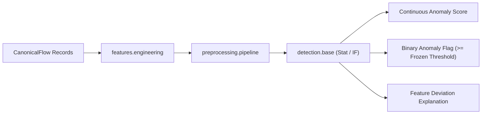

# TrafficShield — Anomaly Detection Architecture (Milestone 4)

Version: 1.0  
Date: 2026-10-22  
Milestone: M4 (Statistical Baseline & Isolation Forest Detectors)

---

## 1. Overview & Core Philosophy

TrafficShield operates on unidirectional network traffic observation links where return-path traffic is invisible and attack labels are unavailable during training. 

The primary anomaly detectors introduced in Milestone 4 are strictly **unsupervised**:
1. **Robust Statistical Detector (`RobustStatisticalDetector`)**: Non-parametric baseline using medians and Median Absolute Deviations (MAD) with zero-MAD fallbacks.
2. **Isolation Forest Detector (`IsolationForestDetector`)**: Ensembled tree-based isolation algorithm wrapping scikit-learn.

---

## 2. Universal Scoring Convention

Across all TrafficShield models, continuous anomaly scores follow a strict unified convention:
$$\text{Score} \in [0, \infty) \quad \text{or} \quad \text{Score} \in \mathbb{R}$$
**HIGHER SCORES STRICTLY AND CONSISTENTLY INDICATE GREATER ANOMALY.**

- In scikit-learn, `IsolationForest.score_samples()` returns negative values where lower indicates greater anomaly. TrafficShield's wrapper inverts this:
  $$\text{anomaly\_score} = - \text{raw\_score}$$
  ensuring downstream alerting, thresholding, and risk-scoring modules receive a uniform signal.
- The statistical detector aggregates normalized deviations such that normal traffic hovers near 0, while extreme deviations produce large positive numbers.

> [!IMPORTANT]
> **Anomaly Scores are NOT Probabilities.**  
> Continuous scores indicate geometric or statistical distance from normal baseline traffic. They must never be interpreted as posterior probabilities of an attack without formal probability calibration.

---

## 3. Robust Statistical Detector

### Formulation
For each eligible numerical feature \(j\):
1. **Calibration Median**: \(\tilde{x}_j = \text{median}(\{x_{1j}, \dots, x_{nj}\})\)
2. **Median Absolute Deviation (MAD)**:
   $$\text{MAD}_j = \text{median}(\{|x_{1j} - \tilde{x}_j|, \dots, |x_{nj} - \tilde{x}_j|\})$$
3. **Consistent Scale Factor**:
   $$\text{scale}_j = \text{MAD}_j \times 1.4826$$
   (The factor \(1.4826 \approx 1 / \Phi^{-1}(0.75)\) ensures asymptotic equality with standard deviation for normally distributed baselines).

### Degenerate Feature & Zero-MAD Fallback
If \(\text{scale}_j \le 10^{-12}\) (e.g. A feature that was constant or near-constant across the entire calibration period):
1. **Step 1**: Check Mean Absolute Deviation (\(\text{MeanAD}_j = \text{mean}(|x_{ij} - \tilde{x}_j|) \times 1.2533\)).
2. **Step 2**: If \(\text{MeanAD}_j \le 10^{-12}\), mark the feature as constant and assign \(\text{scale}_j = \text{zero\_mad\_fallback\_scale}\) (default: `1.0`).
3. **Standardized Deviation**:
   $$z_{ij} = \frac{|x_{ij} - \tilde{x}_j|}{\text{scale}_j}$$
   When a constant training feature deviates at test time, it registers a clean, finite deviation without division-by-zero or `NaN`.

### Aggregation Methods
- **`max` (Default)**: \(\max_j z_{ij}\) (Sensitive to single extreme feature spikes, such as volumetric bursts or port scans).
- **`top_k`**: \(\frac{1}{k} \sum_{r=1}^k z_{i,(r)}\) (Average of top \(k\) most deviant features).
- **`mean`**: \(\frac{1}{d} \sum_{j=1}^d z_{ij}\) (General distributional shift).
- **`l2`**: \(\sqrt{\sum_{j=1}^d z_{ij}^2}\) (Euclidean distance in robust standard score space).

### Explainability
`explain_samples(X, top_n=3)` inspects individual feature deviations and returns the top \(n\) contributing features, their observed values, training medians, MADs, and standardized scores.

---

## 4. Isolation Forest Detector

### Configuration
- `n_estimators`: 100 base isolation trees (configurable).
- `max_samples`: `'auto'` (\(\min(256, n)\)).
- `contamination`: `'auto'` (Determined without attack labels).
- `random_state`: 42 (Reproducible random forest construction).

### Guarantees
- **Strict schema validation**: Incoming feature columns and ordering must match fitted columns.
- **No inference refitting**: Trees are constructed during `fit()` on training/calibration data. Scored batches never mutate tree splits.

---

## 5. Thresholding Policy & Frozen Calibration

Threshold determination is strictly separated from continuous scoring:
1. **Calibration Quantile Method**:
   - The detector is fitted on unlabelled calibration data (e.g. UGR'16 March–June 2016 background).
   - Continuous anomaly scores are calculated across the calibration partition.
   - A threshold is computed at a predetermined false-alarm budget (e.g. 99th percentile: `quantile=0.99`).
2. **Frozen Threshold**:
   - The threshold value is recorded in the model artifact metadata.
   - In production or testing (e.g. July–August 2016), the threshold remains **strictly frozen**.
   - Incoming test batches **never** re-estimate the threshold.

---

## 6. End-to-End Pipeline Flow



---

## 7. Operational Note: Anomalies vs. Malice

> [!CAUTION]
> **An Anomaly is NOT Proof of an Attack.**  
> Unidirectional anomaly detection flags statistically unusual network behavior. Legitimate operational events that cause anomalies include:
> - Scheduled off-site database backups (huge byte bursts)
> - Network topology re-routing or failover events
> - Routine vulnerability scans by internal security audits
> - Flash crowds or software distribution updates  
>
> Anomaly detection provides an **early warning signal** for security analysts, not a substitute for forensic investigation.

---

## 8. Running Tests

Run the Milestone 4 verification suite:
```bash
python -m pytest tests/unit/test_statistical_detector.py tests/unit/test_isolation_forest_detector.py tests/unit/test_detection_artifacts.py tests/unit/test_detection_integration.py -v
```
All tests run in < 3 seconds on synthetic fixtures with zero external dataset downloads.
