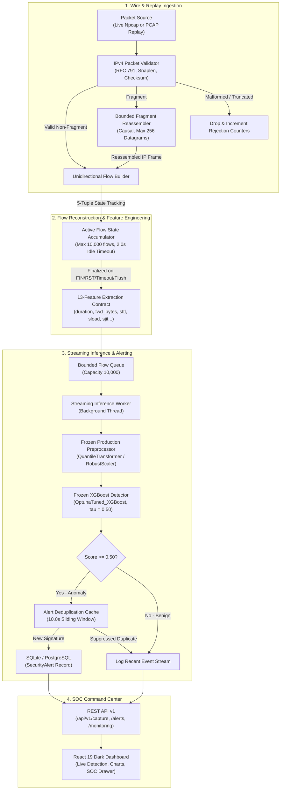

# TrafficShield — Architecture, Dataflow, and Operational Limitations

**Document ID:** TS-DOC-ARCH-LIMITATIONS  
**Auditor / Presenter:** TrafficShield Engineering Team  
**Evaluation Target:** M16 Local Demonstration Readiness  

---

## 1. System Architecture & Pipeline Dataflow

TrafficShield operates as a strictly forward-observable, unidirectional network traffic anomaly detection pipeline. It does not inspect packet payloads, nor does it require visibility into reverse return traffic.

---

## 2. Component Specifications

### 2.1 IPv4 Packet Validator (`ingestion/capture/packet_validator.py`)
- Strictly enforces IPv4 header format (Version == 4, IHL ≥ 5, Total Length ≥ 20).
- Detects wire snaplen truncations where captured bytes are less than IPv4 Total Length.
- Categorizes malformed wire artifacts into `MALFORMED`, `TRUNCATED`, or `UNSUPPORTED`.

### 2.2 Bounded Fragment Reassembler (`ingestion/flow/fragment_reassembler.py`)
- Causally buffers out-of-order IPv4 fragments without reverse integration.
- Enforces hard memory bounding: maximum 256 in-flight datagrams and 10.0-second timeout.
- Drops overlapping fragment attacks (Teardown/Bonsai attacks) to prevent pre-inference buffer corruption.

### 2.3 Unidirectional Flow Builder (`ingestion/flow/flow_builder.py`)
- Directional 5-tuple: `(src_ip, dst_ip, src_port, dst_port, protocol)`.
- Directionally isolated: forward-direction packets only; never merges reverse ACK/data packets.
- Implements RFC 3550 exponential moving average arrival jitter:
  $$J_i = J_{i-1} + \frac{|D(i-1, i)| - J_{i-1}}{16}$$
- Closed guard: `self._is_closed = True` on flush completely blocks late packet ingestion post-teardown.

### 2.4 Frozen Model & 13-Feature Contract
- **Production Preprocessor:** `production_preprocessor.joblib` (SHA-256: `effe96e1977ce9687eb602a953f34f70a42ee1881bf678f59c40b99a1eecc653`).
- **Production Detector:** `production_detector.joblib` (SHA-256: `c43bb5cabd848f930eb7a977b730e401bd8204d6dd63170d1d2f2df2e4d27495`).
- Exact feature contract (13 features in fixed order):
  1. `duration_seconds`
  2. `fwd_bytes`
  3. `sttl`
  4. `sload`
  5. `fwd_packets`
  6. `swin`
  7. `smeansz`
  8. `sjit`
  9. `sintpkt`
  10. `is_sm_ips_ports`
  11. `packet_rate`
  12. `byte_rate`
  13. `bytes_per_packet`
- Decision threshold: **$\tau = 0.50$**.

---

## 3. Mathematical Flow Accounting Invariants

1. **Reconstruction Conservation:**
   $$\text{flows\_created} = \text{flows\_completed} + |\text{active\_flows}|$$
   At final shutdown ($|\text{active\_flows}| = 0$): $\text{flows\_created} = \text{flows\_completed}$.
2. **Completed Flow Decomposition:**
   $$\text{flows\_completed} = \text{flows\_expired\_timeout} + \text{flows\_closed\_tcp} + \text{flows\_evicted\_overflow} + \text{flows\_flushed}$$
3. **Queue Ingestion Invariant:**
   $$\text{flows\_queued} = \text{flows\_completed} - \text{flows\_queue\_dropped}$$
4. **Mutually Exclusive Terminal Outcomes:**
   $$\text{flows\_queued} = \text{flows\_scored} + \text{incompatible\_flows\_rejected} + \text{validation\_errors} + \text{inference\_failures} + \text{unprocessed\_flows}$$
5. **Alert Persistence Invariant:**
   $$\text{anomalies\_detected} = \text{alerts\_persisted} + \text{persistence\_failures} + \text{alerts\_deduplicated}$$

---

## 4. Operational Limitations & Scientific Distinctions

### 4.1 Statistical Anomaly vs. Confirmed Attack
- **What the Model Predicts:** The XGBoost detector outputs a calibrated probability $P(\text{anomaly} \mid \vec{x}) \in [0.0, 1.0]$. This value represents the **multivariate statistical divergence** of an observed flow vector from the benign network traffic patterns present in the training distribution.
- **What the Score Does NOT Mean:** An anomaly score above 0.50 is **not** ground-truth proof of malicious intent, unauthorized intrusion, or exploit execution. Benign traffic exhibiting unusual volume, high packet rates, or novel TTL configurations will also yield elevated anomaly scores.

### 4.2 The Local Wi-Fi TTL Domain Shift
- **Observation:** In M15.1 and M15.3 live tests on local Wi-Fi links, ~52.7% of ambient benign flows were scored anomalous.
- **Root Cause:** Decision tree analysis revealed 254 nodes in the XGBoost ensemble splitting on `sttl` between 62.0 and 64.0. The training dataset (UNSW-NB15) was captured in a multi-hop routed network where initial TTLs were decremented by intermediate routers. In contrast, on an unrouted local 802.11 Wi-Fi link, packets originate with standard operating system defaults:
  - Windows host traffic: initial TTL = 128
  - Local multicast / broadcast (mDNS, SSDP, LLMNR): initial TTL = 255
- Any flow with initial TTL $\ge 128$ crosses multiple tree thresholds, accumulating positive log-odds and driving the anomaly score above 0.50 despite being benign ambient traffic.

---

## 5. Explicit Release Candidate (RC) Qualification Roadmap

TrafficShield is currently certified as **`READY FOR LOCAL DEMONSTRATION`**. Advancing to **`READY FOR RELEASE CANDIDATE`** requires completing three explicit qualification criteria:

1. **Multi-Hour Soak Testing:** Execute an authorized continuous 2-to-4 hour live network capture under production packet rates, certifying continuous RSS memory plateauing across the reassembler, flow builder, and worker.
2. **Native Kernel Ring Buffer Polling:** Implement a ctypes wrapper around Npcap `pcap_stats()` to track kernel-space buffer drops (`ps_drop`, `ps_ifdrop`) alongside user-space queue metrics.
3. **Routed Gateway / SPAN Tap Evaluation:** Validate live capture on an inter-subnet routed link or SPAN port (where packets exhibit multi-hop decremented TTLs and link-local multicast is absent), certifying baseline false-positive rates $< 3.5\%$.
