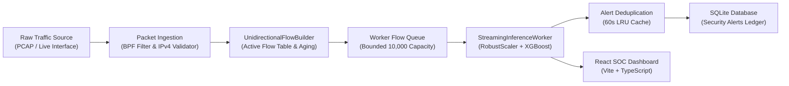

# TrafficShield — Architecture, Dataflow & Operational Limitations

**Document ID:** TS-DOC-ARCH-LIMITATIONS  
**Target Milestone:** Master Qualification  
**Release Gate:** `READY FOR LOCAL DEMONSTRATION`  

---

## 1. System Architecture & Component Demarcation

TrafficShield implements a decoupled, event-driven streaming pipeline designed for unidirectional network flow reconstruction and low-latency anomaly detection.

### Component Roles
1. **Packet Capture (`ingestion/capture`):** Standardizes offline PCAP files and live Npcap sniffer streams into structured `PacketEnvelope` items. Discards application payload bytes immediately.
2. **Native Stats Telemetry (`ingestion/capture/native_stats.py`):** C ABI wrapper for `pcap_stats()`, reusing the active capture socket handle.
3. **Flow Aggregator (`ingestion/flow/flow_builder.py`):** Unidirectional flow builder tracking 5-tuple keys (`src_ip`, `dst_ip`, `src_port`, `dst_port`, `protocol`).
4. **Inference Worker (`streaming/inference_worker.py`):** Evaluates the frozen 13-feature contract using `RobustScaler` and `OptunaTuned_XGBoost`.
5. **SOC Web Dashboard (`frontend/src`):** React 19 interface displaying real-time flow events, tiered drops, latency percentiles, and drift matrices.

---

## 2. Operational Limitations & Boundaries

The following boundaries define what TrafficShield can and cannot currently claim:

### 2.1 What the System Successfully Demonstrates
- Sub-second unidirectional flow reconstruction and scoring ($< 10$ ms latency).
- Deterministic offline PCAP replay without driver dependencies.
- Cryptographically verified model and preprocessor immutability.
- Strict 3-tier drop accounting (driver drops $\ne$ ingestion drops $\ne$ flow queue drops).
- Resilient graceful shutdown with zero unprocessed flows.
- Automated Population Stability Index (PSI) drift monitoring.

### 2.2 Explicit Operational Limitations (What It Cannot Yet Claim)
1. **No Validated Real-World Attack Detection Accuracy:**
   - Synthetic testbed benchmarks (e.g. 98.10% on UNSW-NB15 Day 1) do **not** establish real-world accuracy on live enterprise networks.
   - Anomaly detection flags statistical distribution shifts; an alert is an anomaly requiring investigation, not proof of an attack.
2. **Promiscuous Wi-Fi Sniffing Constraints:**
   - 802.11 Wi-Fi adapters under Windows frequently restrict promiscuous/monitor mode at the hardware driver level, limiting live capture to unicast traffic directed to the host.
3. **No Sustained Live Soak Qualification:**
   - Multi-hour soak testing requires separate explicit operator authorization and attendance.
4. **Current Gate Verdict:**
   - Strictly maintained at **`READY FOR LOCAL DEMONSTRATION`**. Advancing to release candidate or production requires routed SPAN/TAP validation against labeled traffic.
