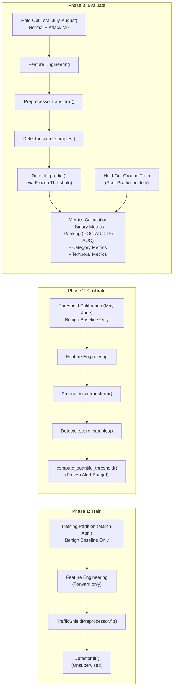

# TrafficShield — Leakage-Safe Evaluation Framework (Milestone 5)

Version: 1.0  
Date: 2026-10-22  
Milestone: M5 (Evaluation Framework)

---

## 1. Evaluation Protocol Architecture

TrafficShield is designed for unidirectional critical-infrastructure links where ground-truth labels cannot be observed during training. To guarantee that model benchmarks reflect realistic operational performance, the Milestone 5 evaluation framework enforces a **strict three-way chronological separation**:



---

## 2. Three Distinct Data Roles

| Role | Dataset Partition | Purpose | Access to Labels | Access to Models |
| :--- | :--- | :--- | :---: | :---: |
| **1. Training** | UGR'16 March–April (Months 03–04) | Fit feature preprocessor (scalers, imputers, one-hot encoders) and detector models. | ❌ Strictly Prohibited | Writes/Updates parameters |
| **2. Threshold Calibration** | UGR'16 May–June (Months 05–06) | Compute continuous anomaly scores on held-out baseline data and establish a **frozen decision threshold** (e.g. 99th percentile alert budget). | ❌ Strictly Prohibited | Read-only; cannot update models or scalers |
| **3. Final Held-Out Test** | UGR'16 July–August (Months 07–08) | Score unseen flows and evaluate detection performance. | ⚠️ Joined **ONLY** post-prediction | Read-only; cannot alter thresholds or models |

---

## 3. Metrics Formulation & Undefined Denominator Policy

### Threshold-Based Metrics
- **True Positives (TP)**, **False Positives (FP)**, **True Negatives (TN)**, **False Negatives (FN)**
- **Precision**: \(\frac{\text{TP}}{\text{TP} + \text{FP}}\) (Measures operational alert fidelity). If \(\text{TP} + \text{FP} = 0\), Precision is set to `None` and added to `undefined_metrics`.
- **Recall / TPR**: \(\frac{\text{TP}}{\text{TP} + \text{FN}}\) (Measures coverage of malicious activity).
- **False Positive Rate (FPR)**: \(\frac{\text{FP}}{\text{FP} + \text{TN}}\).
- **Specificity / TNR**: \(\frac{\text{TN}}{\text{TN} + \text{FP}} = 1 - \text{FPR}\).
- **F1 Score**: \(2 \times \frac{\text{Precision} \times \text{Recall}}{\text{Precision} + \text{Recall}}\).
- **Balanced Accuracy**: \(\frac{\text{TPR} + \text{TNR}}{2}\).

### Threshold-Independent Ranking Metrics
- **ROC-AUC**: Evaluates discrimination ability across all potential decision thresholds.
- **Average Precision (PR-AUC)**: The area under the Precision-Recall curve, essential for highly imbalanced cybersecurity data.
- **Continuous Score Requirement**: Ranking metrics are calculated using continuous anomaly scores (`score_samples()`), **never** from thresholded binary predictions.
- **Single-Class Test Sets**: If an evaluation partition contains only a single class (e.g. background only), ROC-AUC and PR-AUC are mathematically undefined. They return `None` with an explicit warning.

### Category Breakdown
For datasets providing fine-grained attack categories (e.g. UGR'16: `dos`, `scan11`, `scan12`, `nerisbotnet`, `spam`, `blacklist`), `compute_per_category_metrics()` breaks down individual detection counts and recall rates.

---

## 4. Threshold & False-Alarm Analysis

A calibration quantile \(q\) (e.g. \(q = 0.99\) for a target 1% alarm rate) is an **empirical target** chosen on calibration data:
$$\text{Threshold} = \text{Percentile}(\text{Scores}_{\text{cal}}, 100 \times q)$$

> [!WARNING]
> **Calibration Quantiles are Not Production Guarantees.**  
> Under distribution shift, network topology reconfigurations, or software updates, the observed test false-positive rate may diverge from the calibration target. TrafficShield reports this divergence explicitly in `threshold_sweep` without adjusting the frozen threshold post-hoc.

---

## 5. Execution Instructions

### A. Run Synthetic Demonstration CLI (Zero External Downloads)
```bash
# Evaluate Robust Statistical Detector:
python -m evaluation.cli --demo --detector statistical --out-dir reports/m5_demo

# Evaluate Isolation Forest Detector:
python -m evaluation.cli --demo --detector iforest --out-dir reports/m5_demo
```

### B. Evaluate Prepared Real Dataset (e.g. UGR'16 Interim CSV)
```bash
python scripts/evaluate_dataset.py \
    --data datasets/interim/ugr16/ugr16_201603_chunk001.csv \
    --detector iforest \
    --timestamp-col flow_end_ts \
    --label-col eval_label \
    --benign-label background \
    --quantile 0.99 \
    --out-dir reports/ugr16_eval
```

---

## 6. Real-World Limitations

> [!IMPORTANT]
> **Synthetic Success Does NOT Guarantee Real-World Efficacy.**  
> Synthetic benchmarks confirm mathematical correctness, pipeline stability, and leakage prevention. In operational critical-infrastructure environments:
> - Legitimate scheduled backups generate massive volumetric outliers (false alarms).
> - Low-and-slow reconnaissance scans may blend into baseline background variance.
> - Anomaly detection provides an **investigative prioritization signal**, not proof of malicious intent.
