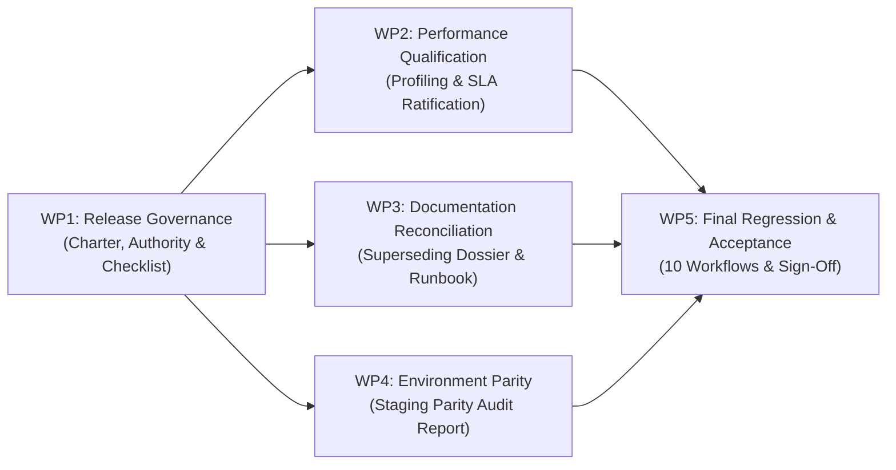

# TrafficShield — Phase 4: Controlled Release Preparation
**Formal Implementation Charter & Release Governance Framework**

**Project:** TrafficShield — Hybrid Intrusion Detection System (Hybrid IDS)  
**Repository:** `D:\projects\trafficshield`  
**Target Branch:** `staging`  
**Governing Document:** `reports/phase4_remediation_and_release_qualification_plan.md`  
**Audit Baseline:** `reports/phase4_closure_evidence_audit.md` (Classification: `INCOMPLETE — EVIDENCE REQUIRED`)  
**Execution Stage:** Work Package WP1 — Release Governance and Documentation  
**Status:** DRAFT / PENDING STAKEHOLDER RATIFICATION  

---

## 1. Project Overview

TrafficShield is an advanced Hybrid Intrusion Detection System (Hybrid IDS) combining:
1. **Supervised XGBoost Classifier**: Trained for high-precision recognition of known attack signatures across 13 engineered flow features.
2. **Unsupervised Isolation Forest**: Trained with 100 decision trees to detect anomalous flow deviations, zero-day behaviors, and novel attack patterns.
3. **4-Tier Hybrid Decision Engine**: Resolving dual detections into explicit operational states:
   - `DUAL_CONFIRMED`
   - `SUPERVISED_ONLY_ALERT`
   - `UNSUPERVISED_NOVELTY`
   - `NORMAL_TRAFFIC`
4. **Hardened Production Serving Infrastructure**: Single-process, multi-threaded Waitress WSGI runtime (`wsgi.py`), startup preflight integrity checks (`app/lifecycle.py`), atomic monitoring persistence, and database retention lifecycle management.

### Project Lifecycle Context
- **Phases 1–3**: Fully executed and formally closed (`reports/m16_final_evaluation.md`, Phase 3 Closure Verdict: `PASS`).
- **Phase 4**: **Controlled Release Preparation** (The subject of this charter). Identified as `INCOMPLETE — EVIDENCE REQUIRED` due to omission of formal governance, un-updated historical dossiers, and an unresolved single-flow inference latency SLA benchmark.
- **Phase 5**: Production Reliability, Serving Architecture & Storage Lifecycle (`reports/phase5_consolidated_closure_report.md`, Verdict: `PASS WITH LIMITATIONS`).
- **Phase 6**: Security Hardening & Performance Stress Qualification (Scheduled).
- **Phase 7**: Production Deployment, Observability & Operational Handover (Scheduled).

---

## 2. Phase 4 Objectives

The overarching purpose of Phase 4 is to establish a verified, documented, and approved **Release Candidate (RC)** baseline prior to Phase 6 security stress testing and Phase 7 production deployment.

### A. Original Objectives (Reconstructed from Governance Baselines)
1. **Hybrid Release Packaging**: Package the dual-detector inference pipeline across all REST endpoints and streaming workers.
2. **End-to-End Workflow Re-qualification**: Validate all 10 end-to-end release workflows under the hybrid model architecture.
3. **Environment Hardening & Parity**: Enforce production configuration validation, database connection pooling, and strict CORS controls.
4. **Operational Runbooks**: Publish verified operator manuals and clean-install verification checklists.
5. **Release Governance Sign-Off**: Conduct formal independent review and obtain authorized stakeholder approval.

### B. Newly Approved Remediation Objectives (Per Remediation Plan)
1. **Formal Release Charter & Sign-Off Matrix**: Establish objective governance gates, role authorities, and acceptance criteria.
2. **Scientific Performance Qualification**: Conduct multi-stage isolated profiling of the hybrid pipeline (preprocessing vs. XGBoost vs. Isolation Forest vs. transport) to establish an empirical, stakeholder-approved SLA.
3. **Superseding Release Dossier**: Author `reports/phase4_release_dossier.md` to replace obsolete single-detector documentation without altering historical records.
4. **Staging vs. Local Parity Audit**: Publish `reports/phase4_staging_parity_audit.md` certifying database, pooling, and configuration parity between local testing and staging targets.
5. **Regression Verification**: Achieve 100% test pass rate across the full test suite under the ratified SLA baseline.

---

## 3. Scope and Out-of-Scope Items

### In-Scope Items
- Authoring governance charters, sign-off matrices, and acceptance checklists (WP1).
- Isolated performance profiling and empirical latency distributions across 100 iterations (WP2).
- Proposing evidence-based SLA adjustments to stakeholders for formal review (WP2).
- Authoring superseding release dossiers and updated operational runbooks for `python wsgi.py` (WP3).
- Documenting environment parity across local Windows Waitress and staging environments (WP4).
- Executing regression test suites and recording formal stakeholder sign-off (WP5).

### Out-of-Scope Items
- Modifying frozen model weights, preprocessor pipelines, decision thresholds, or feature definitions.
- Modifying application source code or frontend business logic.
- Connecting to or executing queries, migrations, or downgrades against production databases.
- Installing, upgrading, or modifying runtime dependencies in `pyproject.toml` or `package.json`.
- Executing high-concurrency stress testing, multi-worker scaling, or penetration testing (Reserved for Phase 6).
- Production cloud deployment execution or DNS switchover (Reserved for Phase 7).

---

## 4. Summary of Audit Findings

The Phase 4 closure evidence audit (`reports/phase4_closure_evidence_audit.md`) established the following factual baseline across 14 requirements:
- **Verified:** 6 requirements (42.9%)
- **Partially Verified:** 4 requirements (28.6%)
- **Not Verified:** 3 requirements (21.4%)
- **Failed:** 1 requirement (7.1%)

```
┌────────────────────────────────────────────────────────────────────────────────────────┐
│                              PHASE 4 AUDIT SUMMARY MATRIX                              │
├────────────┬───────────────────────────────────────┬───────────────────┬───────────────┤
│ Issue ID   │ Finding Description                   │ Audit Result      │ Severity      │
├────────────┼───────────────────────────────────────┼───────────────────┼───────────────┤
│ ISSUE-P4-01│ Missing Formal Release Governance     │ NOT VERIFIED      │ HIGH          │
│ ISSUE-P4-02│ Single-Flow Latency SLA (< 35 ms)     │ FAILED (REQ-P4-03)│ HIGH          │
│ ISSUE-P4-03│ Obsolete Historical Release Dossiers  │ PARTIALLY VERIFIED│ MEDIUM        │
│ ISSUE-P4-04│ Staging and Local Deployment Parity   │ NOT VERIFIED      │ LOW           │
└────────────┴───────────────────────────────────────┴───────────────────┴───────────────┘
```

---

## 5. Five Remediation Work Packages

Remediation is partitioned into five distinct, tightly scoped work packages:



1. **WP1 — Release Governance and Documentation**:
   - Establish formal charters, authority matrices, and gate definitions.
   - Deliverables: Implementation Charter, Authority Matrix, Acceptance Checklist, WP1 Completion Report.
2. **WP2 — Hybrid Inference Performance Qualification**:
   - Conduct isolated component latency profiling (10 warmup, 100 timed iterations).
   - Evaluate p50, p95, and p99 percentiles for single-flow and batch processing.
   - Deliverables: Benchmark harness script, Performance Qualification Report, formal SLA proposal.
3. **WP3 — Historical Release Dossier Reconciliation**:
   - Author unified hybrid release dossier superseding obsolete Milestone 14 records.
   - Update operational runbooks to standardize on `python wsgi.py`.
   - Deliverables: Release Dossier, Release Readiness Checklist, Operational Runbook.
4. **WP4 — Environment and Deployment Parity**:
   - Audit configuration, database pooling, and CORS policies across deployment targets.
   - Deliverables: Environment Parity Matrix, Staging Parity Audit Report.
5. **WP5 — Final Regression and Release Acceptance**:
   - Re-run full test suite and verify all 10 release workflows under ratified SLA.
   - Deliverables: Release Verification Report, Formal Operator Sign-Off Document.

---

## 6. Milestone Execution Order and Dependencies

The sequential execution stages and gating prerequisites are strictly defined:

```
STAGE 1: Governance & Scope Baseline (WP1) 
   └── Required: Charter, Authority Matrix & Acceptance Checklist published.
   └── Prerequisite for all subsequent stages.

STAGE 2: Parallel Audits (WP3 & WP4)
   ├── Stream A: Superseding Release Dossier and WSGI Runbook (WP3).
   └── Stream B: Staging Environment Parity Audit (WP4).

STAGE 3: Scientific Performance Qualification (WP2)
   ├── Non-mutating component latency profiling (100 runs).
   ├── Presentation of empirical distributions to stakeholders.
   └── Formal ratification of dual-model SLA by authorized roles.

STAGE 4: Final Regression & Closure Sign-Off (WP5)
   ├── Full automated test execution (725 tests).
   ├── Verification of all 10 release workflows.
   └── Formal Phase 4 Operator Sign-Off execution.
```

---

## 7. Risks and Mitigation Strategy

| Risk ID | Risk Description | Severity | Likelihood | Mitigation Action |
| :--- | :--- | :---: | :---: | :--- |
| **RSK-P4-01** | **SLA Ratification Stall**: Disagreement among stakeholders regarding revised dual-model SLA. | HIGH | MEDIUM | Provide irrefutable component-level profiler data showing pure CPU tree traversal bounds (~33.25 ms). Offer dual-tier SLA option (supervised vs. hybrid). |
| **RSK-P4-02** | **Accidental Model Artifact Mutation**: Testing alters frozen `.joblib` or `.json` model files. | HIGH | LOW | Maintain SHA-256 preflight checks before and after every execution. Abort immediately if hashes diverge. |
| **RSK-P4-03** | **Hardware Profiling Jitter**: Operating system background tasks inflate latency percentiles. | MEDIUM | HIGH | Enforce strict profiling protocol: 10 warmup iterations, 100 timed iterations, reporting median (p50) and p95 alongside mean. |
| **RSK-P4-04** | **Documentation Drift**: Operational guides desynchronize from code updates. | LOW | MEDIUM | Establish `reports/phase4_release_dossier.md` as the single authoritative source of truth. |

---

## 8. Objective Release Gate Definitions

Promotion of Phase 4 through each development milestone requires formal verification of objective release gates:

### Gate 1: Governance Gate
- [ ] Phase 4 Implementation Charter published and ratified.
- [ ] Sign-Off Authority Matrix defined with clear escalation paths.
- [ ] Acceptance Checklist established with all 14 audit requirements preserved.

### Gate 2: Documentation Gate
- [ ] Superseding `reports/phase4_release_dossier.md` authored.
- [ ] Obsolete references to `run_waitress.py` eliminated in newly authored runbooks.
- [ ] Historical records in `reports/m14_release/` preserved intact as archived baselines.

### Gate 3: Environment Parity Gate
- [ ] Formal Staging Parity Audit Report (`reports/phase4_staging_parity_audit.md`) published.
- [ ] SQLite in-memory test isolation and PostgreSQL staging pool safety (`pool_pre_ping`) verified.
- [ ] CORS policies and cookie security configurations verified across environments.

### Gate 4: Performance Qualification Gate
- [ ] Isolated latency profiling executed across 100 warm iterations with full percentile reporting (p50, p95, p99).
- [ ] **Crucial Rule**: The legacy 35.0 ms latency benchmark remains marked as **FAILED** until formally reviewed and resolved.
- [ ] **Crucial Rule**: The proposed 120 ms mean and 180 ms P95 hybrid SLA remain **unapproved proposals** until supported by reproducible measurements and signed off by designated stakeholder authorities.
- [ ] Test assertion in `test_single_flow_latency_benchmark` updated **only after** formal stakeholder authorization.

### Gate 5: Security and Regression Gate
- [ ] Full automated test suite achieves 100% pass rate (zero failing tests).
- [ ] All 10 end-to-end integration workflows in `test_m14_end_to_end_release.py` pass.
- [ ] RBAC enforcement, cryptographic token expiration, and security headers verified.

### Gate 6: Final Operator Acceptance Gate
- [ ] Independent QA audit report confirms satisfaction of all 14 requirements.
- [ ] Formal Operator Sign-Off Document signed and dated by all designated authorities.
- [ ] Phase 4 status formally upgraded to **`PASS`**.

---

## 9. Change-Control and Evidence Policy

To maintain DevSecOps integrity and prevent unauthorized modifications:

1. **Proposal and Review Process**: Any technical modification to application configuration, test assertions, or deployment scripts must be proposed via a documented remediation task citing specific audit findings.
2. **Benchmark & SLA Modification Protocol**:
   - No engineer may unilaterally edit or weaken latency assertions in `tests/integration/test_m14_end_to_end_release.py`.
   - Any SLA modification requires:
     1. Reproducible profiling logs published in `reports/phase4_performance_qualification.md`.
     2. Formal written concurrence from both the *Lead ML Engineer* and *QA Lead*.
     3. An explicit commit message documenting the approved change.
3. **Protection of Frozen Model Artifacts**:
   - The 5 production model artifacts (`production_detector.joblib`, `production_detector.json`, `production_iforest.joblib`, `production_iforest.json`, and `production_preprocessor.joblib`) are permanently frozen.
   - No retraining, pruning, threshold tuning, or feature reordering is permitted under Phase 4.
   - SHA-256 hashes must match the frozen baseline exactly:
     - `production_detector.joblib`: `c43bb5cabd848f930eb7a977b730e401bd8204d6dd63170d1d2f2df2e4d27495`
     - `production_detector.json`: `3553f1a47c1c2fd67b031cadb42400246997778f8dcf42026e2ebfb882ba73b1`
     - `production_iforest.joblib`: `d9fe41016c51f8484b57c80bb2f0ec41186c66add9bae71f822d0a85c13a350e`
     - `production_iforest.json`: `5daf8b0dab1c4c3a66e4cb2c38b10c406f6c1861572d27a08155c8541bf4cb94`
     - `production_preprocessor.joblib`: `effe96e1977ce9687eb602a953f34f70a42ee1881bf678f59c40b99a1eecc653`
4. **Production Database Safety**:
   - All automated test runs must execute against SQLite in-memory databases (`TEST_DATABASE_URL=sqlite:///:memory:`).
   - Direct execution of migrations, downgrades, or retention deletes against production PostgreSQL databases during remediation is strictly prohibited.
5. **Evidence Archival**: All test outputs, terminal runs, and benchmark JSON artifacts must be stored under `reports/` with timestamps and cryptographic checksums.
6. **Escalation Protocol**: If any regression or defect cannot be resolved within the scope of a work package, it must be escalated immediately to the *Project Owner / Final Release Authority* for triage.

---

## 10. Release Completion Conditions

Phase 4 Controlled Release Preparation shall be deemed formally complete when:
1. All 5 work packages (WP1 through WP5) have generated their required deliverables.
2. All 6 objective release gates have been independently evaluated and marked **PASS**.
3. The Requirement Traceability Matrix reflects:
   - **Verified:** 14 requirements (100%)
   - **Partially Verified:** 0
   - **Not Verified:** 0
   - **Failed:** 0
4. The formal Phase 4 Operator Sign-Off Document has been signed and dated by all designated authorities.
5. Phase 5 formal sign-off review convenes to confirm resolution of inherited limitations.
6. The project is formally cleared to initiate **Phase 6: Security and Performance Qualification**.

---
*Charter established under Work Package WP1. Awaiting formal stakeholder review.*
