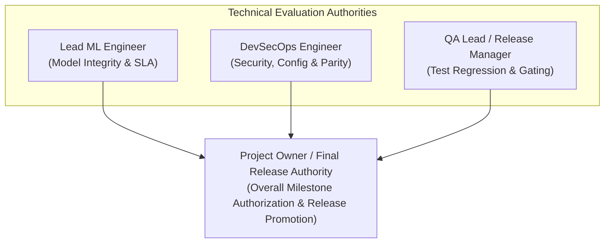
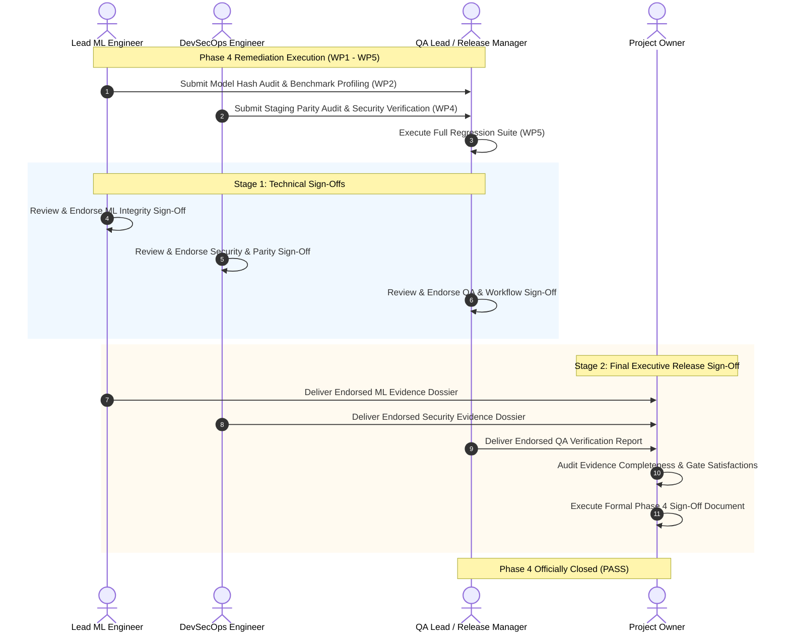

# TrafficShield — Phase 4: Controlled Release Preparation
**Stakeholder Sign-Off Authority Matrix and Governance Roles**

**Project:** TrafficShield — Hybrid Intrusion Detection System (Hybrid IDS)  
**Repository:** `D:\projects\trafficshield`  
**Target Branch:** `staging`  
**Governing Document:** `docs/phase4_implementation_charter.md`  
**Execution Stage:** Work Package WP1 — Release Governance and Documentation  
**Status:** DRAFT / PENDING STAKEHOLDER APPOINTMENT  

---

## 1. Purpose and Authority Principles

This document establishes the formal authority matrix, role responsibilities, evidence verification requirements, and sign-off hierarchy for **Phase 4: Controlled Release Preparation**.

### Core Governance Principles
1. **Separation of Duties**: Technical evaluation, security validation, QA certification, and release authorization are decoupled across distinct governance roles.
2. **Evidence-Based Approval**: Approvals cannot be granted based on verbal assurances or implementation artifacts alone; every sign-off requires verifiable test reports, hash audits, or documented benchmarks.
3. **Unanimous Gate Concurrence**: Promotion of the Phase 4 Release Candidate to closed status requires explicit concurrence from all four designated roles within their respective domains.
4. **Placeholder Protocol**: In accordance with strict audit standards, actual human stakeholder names and execution dates are represented by formal placeholders until real-world stakeholder convening. No fictitious identities or fabricated signatures are permitted.

---

## 2. Stakeholder Role Definitions

---

### Role 1: Lead Machine Learning Engineer

- **Designated Role Title**: Lead ML Engineer
- **Appointee Name**: `[STAKEHOLDER_NAME_PLACEHOLDER]`
- **Appointed Date**: `[YYYY-MM-DD]`

#### Key Responsibilities
- Verify the mathematical validity, serialization parity, and feature alignment of both production detectors (XGBoost and Isolation Forest).
- Ensure input flow feature ordering is immutable across 13 features.
- Validate decision threshold calibration: XGBoost (`0.50`), Isolation Forest (`0.7278956397776036`).
- Review and co-authorize performance qualification benchmarks and proposed SLA adjustments.

#### Required Evidence Review
- Cryptographic SHA-256 hash validation logs for all 5 production artifacts (`artifacts/models/*`).
- `production_detector.json` and `production_iforest.json` manifest schemas.
- Profiler latency distributions and component breakdown in `reports/phase4_performance_qualification.md`.
- `tests/unit/test_hybrid_inference_service.py` execution logs.

#### Approval Authority
- Sole authority to certify ML model integrity, manifest consistency, and feature policy compliance.
- Co-approval authority (with QA Lead) for any modification to inference latency SLAs or benchmark assertions.

#### Rejection Authority
- Unconditional veto if model artifacts are altered, retrained, corrupted, or if decision thresholds are modified.
- Veto on any proposed latency SLA that violates operational intrusion detection requirements.

#### Escalation Responsibilities
- Escalate any model drift, feature policy divergence, or scikit-learn/XGBoost library compatibility conflicts to the *Project Owner*.

---

### Role 2: DevSecOps Engineer

- **Designated Role Title**: DevSecOps Engineer
- **Appointee Name**: `[STAKEHOLDER_NAME_PLACEHOLDER]`
- **Appointed Date**: `[YYYY-MM-DD]`

#### Key Responsibilities
- Enforce secure configuration management across local, testing, staging, and production environments.
- Verify Role-Based Access Control (RBAC), cryptographic session token generation, and cookie defense-in-depth.
- Ensure strict database connection pool resilience (`pool_pre_ping=True`, `pool_recycle=300`) and socket disposal.
- Enforce CORS origin restrictions and HTTP defense headers (nosniff, DENY, CSP).

#### Required Evidence Review
- Configuration schema in `config/settings.py` and environment enforcement in `app/__init__.py`.
- `tests/unit/test_m13_production_security.py` and `tests/unit/test_capture_auth.py` logs.
- Staging Parity Audit Report (`reports/phase4_staging_parity_audit.md`).
- Startup preflight verification and graceful shutdown logs in `test_production_wsgi.py`.

#### Approval Authority
- Sole authority to certify environment parity, network security headers, secret protection, and database connection safety.

#### Rejection Authority
- Unconditional veto if wildcard CORS (`*`) is present in production settings, if secrets are hardcoded, or if production database records are accessed unsafely during automated testing.

#### Escalation Responsibilities
- Escalate any SSL configuration failure, database deadlock risk, or credential leakage vulnerability to the *Project Owner*.

---

### Role 3: QA Lead / Release Manager

- **Designated Role Title**: QA Lead / Release Manager
- **Appointee Name**: `[STAKEHOLDER_NAME_PLACEHOLDER]`
- **Appointed Date**: `[YYYY-MM-DD]`

#### Key Responsibilities
- Oversee execution of the full regression test suite (725+ tests) and end-to-end integration workflows.
- Monitor and audit all 6 objective release gates defined in the Implementation Charter.
- Validate that the single-flow latency benchmark (`test_single_flow_latency_benchmark`) passes under the ratified SLA.
- Compile and publish the final Phase 4 Release Verification Report.

#### Required Evidence Review
- Pytest execution outputs from `pytest tests -v` (unit, integration, and security suites).
- End-to-end integration results in `tests/integration/test_m14_end_to_end_release.py`.
- Requirement Traceability Matrix reconciliation verifying 14/14 requirements.
- Unified Hybrid Release Dossier (`reports/phase4_release_dossier.md`).

#### Approval Authority
- Sole authority to certify test suite regression integrity, workflow qualification, and release readiness checklists.
- Co-approval authority (with Lead ML Engineer) for benchmark SLA adjustment.

#### Rejection Authority
- Unconditional veto if any non-deprecated automated test fails, if test assertions are weakened without formal authorization, or if test coverage regresses.

#### Escalation Responsibilities
- Escalate persistent test failures, flaky integration workflows, or unresolved release blockers to the *Project Owner*.

---

### Role 4: Project Owner / Final Release Authority

- **Designated Role Title**: Project Owner / Final Release Authority
- **Appointee Name**: `[STAKEHOLDER_NAME_PLACEHOLDER]`
- **Appointed Date**: `[YYYY-MM-DD]`

#### Key Responsibilities
- Serve as the ultimate executive authority for TrafficShield release governance.
- Review consolidated evidence dossiers, audit findings, and technical sign-offs from ML, DevSecOps, and QA Leads.
- Authorize promotion of Phase 4 from `INCOMPLETE` to formally closed `PASS`.
- Authorize progression to Phase 5 sign-off review and Phase 6 implementation.

#### Required Evidence Review
- `reports/phase4_closure_evidence_audit.md`.
- `reports/phase4_remediation_and_release_qualification_plan.md`.
- `reports/phase4_release_verification_report.md`.
- Signed concurrence endorsements from Lead ML Engineer, DevSecOps Engineer, and QA Lead.

#### Approval Authority
- Sole authority to execute the final Phase 4 Operator Sign-Off Document and declare Phase 4 closed.
- Authority to approve phase boundary progression and resource allocation for subsequent phases.

#### Rejection Authority
- Unconditional executive veto over any release milestone if project governance, regulatory compliance, or operational reliability standards are unmet.

#### Escalation Responsibilities
- Resolve deadlocks or technical disputes between ML, DevSecOps, and QA Leads.

---

## 3. Evidence Review and Approval Workflow

---

## 4. Formal Sign-Off Record Template

*This section defines the formal sign-off template to be executed upon completion of Work Packages WP1 through WP5. In accordance with strict audit rules, signatures remain unexecuted placeholders.*

| Governance Role | Designated Authority Placeholder | Concurrence Status | Review Date | Digital Signature / Authorization |
| :--- | :--- | :---: | :---: | :---: |
| **Lead ML Engineer** | `[LEAD_ML_ENGINEER_NAME]` | `[PENDING_REVIEW]` | `[YYYY-MM-DD]` | `[UNEXECUTED_PLACEHOLDER]` |
| **DevSecOps Engineer** | `[DEVSECOPS_ENGINEER_NAME]` | `[PENDING_REVIEW]` | `[YYYY-MM-DD]` | `[UNEXECUTED_PLACEHOLDER]` |
| **QA Lead / Release Manager** | `[QA_LEAD_NAME]` | `[PENDING_REVIEW]` | `[YYYY-MM-DD]` | `[UNEXECUTED_PLACEHOLDER]` |
| **Project Owner / Release Authority** | `[PROJECT_OWNER_NAME]` | `[PENDING_REVIEW]` | `[YYYY-MM-DD]` | `[UNEXECUTED_PLACEHOLDER]` |

---
*Authority Matrix formulated under Work Package WP1. Awaiting formal stakeholder convening.*

---

## 5. Addendum: Release Governance Board Review Preparation (November 5, 2026)

### 5.1 Governance Convening Status
Pursuant to the governance preparation mandate, the complete Release Governance Board Review Package has been finalized and indexed across the repository:
- **Governance Board Review Package:** [`reports/phase4_release_governance_board_package.md`](file:///d:/projects/trafficshield/reports/phase4_release_governance_board_package.md)
- **Governance Decision Register:** [`reports/phase4_governance_decision_register.md`](file:///d:/projects/trafficshield/reports/phase4_governance_decision_register.md)
- **Stakeholder Sign-Off Record:** [`reports/phase4_stakeholder_signoff_record.md`](file:///d:/projects/trafficshield/reports/phase4_stakeholder_signoff_record.md)
- **Formal Closure Checklist:** [`reports/phase4_formal_closure_checklist.md`](file:///d:/projects/trafficshield/reports/phase4_formal_closure_checklist.md)
- **Governance Risk Register:** [`reports/phase4_governance_risk_register.md`](file:///d:/projects/trafficshield/reports/phase4_governance_risk_register.md)
- **Governance Review Summary:** [`reports/phase4_governance_review_summary.md`](file:///d:/projects/trafficshield/reports/phase4_governance_review_summary.md)

### 5.2 Designated Stakeholder Sign-Off Alignment
The five designated authority roles have been aligned across all review artifacts:
1. **Release Manager:** Gate authority, milestone transition, change control.
2. **Principal Software Architect:** Architectural safety, 13-feature contract, concurrency.
3. **DevSecOps Lead:** Database pooling, configuration isolation, operational runbook.
4. **Lead Machine Learning Engineer:** Model deserialization, artifact integrity, threshold freezing.
5. **Independent QA Auditor:** Test regression suite (60/60 passing), benchmark verification.

All formal signature blocks remain unexecuted placeholders awaiting the physical or cryptographic execution by human stakeholders at the convened board meeting.

