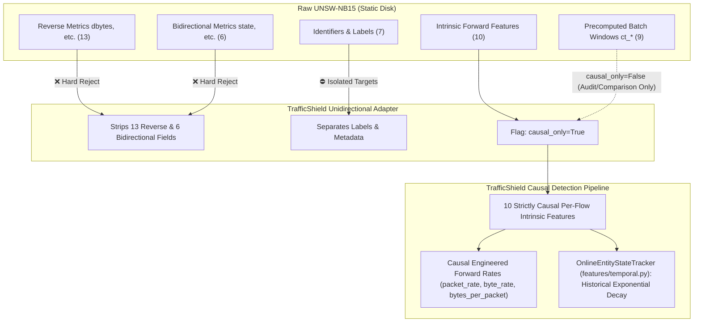

# TrafficShield — UNSW-NB15 Causal Observability and Directionality Audit

**Document Version:** 1.0  
**Milestone:** 7.1  
**Project:** TrafficShield — Unidirectional IP Traffic Anomaly Detection  
**Core Premise:** TrafficShield operates on monitoring links where sensors observe only forward traffic (source to destination) and where detection models must operate causally in real time without future lookahead, reverse-link observations, or bidirectional state synchronization.

---

## 1. Executive Summary and Evaluation Framework

In network intrusion datasets (such as UNSW-NB15), feature engineering is frequently performed in offline batch environments using tools like Argus, Bro/Zeek, and custom post-capture scripts. These pipelines often introduce two subtle forms of data leakage:

1. **Reverse-Direction Dependence:** Computing metrics requiring knowledge of packets returning from the destination (e.g., round-trip times, server response bodies, return packet counts).
2. **Temporal Lookahead / Non-Causal Windowing:** Computing aggregation counts over a sliding or batch window of connections that includes flows occurring *after* the current observation timestamp (future lookahead bias).

TrafficShield formally audits every candidate feature across 6 strict criteria:

| Criterion | Evaluation Question | TrafficShield Requirement |
|---|---|---|
| **C1. Observability** | Can the underlying packets be observed from the forward link alone? | Must be forward-only |
| **C2. Directionality** | Does the metric depend on destination-to-source packets or TCP replies? | Zero reverse dependence |
| **C3. Temporal Causality** | Does the value depend on future flows or batch-centered windows? | Strictly causal (past/present only) |
| **C4. Inference Computability** | Can an online sensor compute this feature at flow termination or in-flight? | Must be computable online |
| **C5. Split Isolation** | Can this feature leak information across train/calibration/test boundaries? | Zero cross-partition leakage |
| **C6. Policy Classification** | Final status: Strict Causal Feature, Batch Window Candidate, or Prohibited? | Documented and programmatically enforced |

---

## 2. In-Depth Audit of Candidate Features

### 2.1 Per-Flow Forward Intrinsic Features (Strictly Causal)

#### `swin` — Source TCP Window Advertisement Value
- **What it measures:** The 16-bit TCP receive window size advertised in TCP packet headers sent by the source endpoint to the destination.
- **Forward Observability:** **Yes.** Present directly in every forward TCP packet header ($S \to D$).
- **Reverse Dependence:** **No.** Observed exclusively on the forward link.
- **Temporal Dependency:** **Per-flow intrinsic.** No dependency on prior or future flows.
- **Inference-Time Computability:** Extracted instantaneously from the TCP header of observed forward packets.
- **Partition Leakage Risk:** **Zero.** Flow-local metric.
- **Policy Classification:** `FORWARD_OBSERVABLE` (Strict Causal Model Feature).

#### `Sload` — Source Bits per Second
- **What it measures:** Forward throughput: $(sbytes \times 8) / dur$.
- **Forward Observability:** **Yes.** Derived from forward byte counter and duration between first and last observed forward packet.
- **Reverse Dependence:** **No.** Does not observe destination bytes ($Dload$).
- **Temporal Dependency:** **Per-flow intrinsic.** Measured over the lifespan of the observed forward flow.
- **Inference-Time Computability:** Computed online upon flow expiration: `(fwd_bytes * 8) / max(duration_seconds, 1e-6)`.
- **Partition Leakage Risk:** **Zero.**
- **Policy Classification:** `FORWARD_OBSERVABLE` (Strict Causal Model Feature).

#### `Sjit` — Source Jitter (mSec)
- **What it measures:** Variance in inter-packet arrival times within the source packet stream:
  $$J_{\text{src}} = \frac{1}{N-1} \sum_{i=1}^{N-1} \left| \Delta t_{i+1} - \Delta t_i \right|$$
- **Forward Observability:** **Yes.** Computed strictly from packet arrival timestamps recorded at the forward monitoring link.
- **Reverse Dependence:** **No.** Entirely independent of return packet jitter ($Djit$).
- **Temporal Dependency:** **Per-flow intrinsic.** Operates only across packets belonging to the active forward flow.
- **Inference-Time Computability:** Maintained in online rolling packet registers during flow reassembly.
- **Partition Leakage Risk:** **Zero.**
- **Policy Classification:** `FORWARD_OBSERVABLE` (Strict Causal Model Feature).

#### `Sintpkt` — Source Inter-Packet Arrival Time (mSec)
- **What it measures:** Mean time interval between consecutive packets transmitted by the source:
  $$\overline{\Delta t}_{\text{src}} = \frac{dur}{Spkts - 1}$$
- **Forward Observability:** **Yes.** Recorded at the forward sensor interface.
- **Reverse Dependence:** **No.** Return packet arrival times ($Dintpkt$) are unobserved and excluded.
- **Temporal Dependency:** **Per-flow intrinsic.**
- **Inference-Time Computability:** Online calculation at flow termination.
- **Partition Leakage Risk:** **Zero.**
- **Policy Classification:** `FORWARD_OBSERVABLE` (Strict Causal Model Feature).

#### `is_sm_ips_ports` — Same Source/Destination IP and Port Indicator
- **What it measures:** Binary indicator: 1 if $\text{src\_ip} == \text{dst\_ip}$ and $\text{src\_port} == \text{dst\_port}$, else 0 (Land attack signature).
- **Forward Observability:** **Yes.** Header fields are fully observable in the single forward packet.
- **Reverse Dependence:** **No.**
- **Temporal Dependency:** **Per-flow intrinsic.**
- **Inference-Time Computability:** Single comparison in packet parser.
- **Partition Leakage Risk:** **Zero.**
- **Policy Classification:** `FORWARD_OBSERVABLE` (Strict Causal Model Feature).

---

### 2.2 Precomputed Batch-Window Aggregate Features (`ct_*`)

The UNSW-NB15 dataset includes 10 connection count features (`ct_*`). In the dataset documentation (Moustafa & Slay, 2015), these are defined as:
> *"No. of connections that contain the same service (14) and source address (1) in 100 connections according to the last time (26)."*

#### Empirical Investigation of Lookahead Bias
To determine whether the precomputed `ct_*` fields in `UNSW-NB15_1.csv` are causal (historical only) or non-causal (including future flows), an empirical inspection of Row 0 (the first flow in the dataset) was conducted:

```
Row 0:  src=59.166.0.0, service=dns, Ltime=1421927414, ct_srv_src=3
Row 27: src=59.166.0.0, service=dns, Ltime=1421927416, ct_srv_src=3
Row 37: src=59.166.0.0, service=dns, Ltime=1421927417, ct_srv_src=3
```

**Finding:** At Row 0—before any other connections have been observed—`ct_srv_src` already has a value of `3`. It anticipates and counts flows occurring 2 seconds (Row 27) and 3 seconds (Row 37) in the future.

This proves empirically that the precomputed `ct_*` features in raw UNSW-NB15 were generated using **offline batch-centered windows** spanning both past and future connections.

#### Individual Analysis of Precomputed Fields

#### `ct_srv_src`
- **What it measures:** Count of connections sharing the same requested service and source IP within a 100-connection window.
- **Forward Observability:** Directionally forward (source IP and service requested).
- **Temporal Causality:** **Non-Causal in Raw Dataset.** Includes future flows across the 100-connection batch window.
- **Cross-Partition Leakage Risk:** **High.** Flows near partition boundaries leak future connection density from calibration or test splits into training observations.
- **Policy Classification:** `FORWARD_OBSERVABLE` (Candidate), **Excluded from Strict Causal Pipeline.**

#### `ct_srv_dst`
- **What it measures:** Count of connections sharing the same destination IP and service within a 100-connection window.
- **Forward Observability:** Directionally forward (destination IP and service).
- **Temporal Causality:** **Non-Causal in Raw Dataset.** Future lookahead across window.
- **Policy Classification:** `FORWARD_OBSERVABLE` (Candidate), **Excluded from Strict Causal Pipeline.**

#### `ct_dst_ltm`
- **What it measures:** Count of connections to the same destination IP in 100 connections.
- **Forward Observability:** Directionally forward.
- **Temporal Causality:** **Non-Causal in Raw Dataset.**
- **Policy Classification:** `FORWARD_OBSERVABLE` (Candidate), **Excluded from Strict Causal Pipeline.**

#### `ct_src_ltm`
- **What it measures:** Count of connections from the same source IP in 100 connections.
- **Forward Observability:** Directionally forward.
- **Temporal Causality:** **Non-Causal in Raw Dataset.**
- **Policy Classification:** `FORWARD_OBSERVABLE` (Candidate), **Excluded from Strict Causal Pipeline.**

#### `ct_src_dport_ltm`
- **What it measures:** Connections from same source IP to same destination port (horizontal scan indicator).
- **Forward Observability:** Directionally forward.
- **Temporal Causality:** **Non-Causal in Raw Dataset.**
- **Policy Classification:** `FORWARD_OBSERVABLE` (Candidate), **Excluded from Strict Causal Pipeline.**

#### `ct_dst_sport_ltm`
- **What it measures:** Connections to same destination IP from same source port (vertical scan indicator).
- **Forward Observability:** Directionally forward.
- **Temporal Causality:** **Non-Causal in Raw Dataset.**
- **Policy Classification:** `FORWARD_OBSERVABLE` (Candidate), **Excluded from Strict Causal Pipeline.**

#### `ct_dst_src_ltm`
- **What it measures:** Host-pair connection density between source and destination IP.
- **Forward Observability:** Directionally forward.
- **Temporal Causality:** **Non-Causal in Raw Dataset.**
- **Policy Classification:** `FORWARD_OBSERVABLE` (Candidate), **Excluded from Strict Causal Pipeline.**

#### `ct_flw_http_mthd`
- **What it measures:** Count of flows using HTTP request methods (GET, POST) in 100 connections.
- **Forward Observability:** Directionally forward.
- **Temporal Causality:** **Non-Causal in Raw Dataset.**
- **Policy Classification:** `FORWARD_OBSERVABLE` (Candidate), **Excluded from Strict Causal Pipeline.**

#### `ct_ftp_cmd`
- **What it measures:** Count of flows containing FTP command strings in 100 connections.
- **Forward Observability:** Directionally forward.
- **Temporal Causality:** **Non-Causal in Raw Dataset.**
- **Policy Classification:** `FORWARD_OBSERVABLE` (Candidate), **Excluded from Strict Causal Pipeline.**

---

## 3. Architectural Solution: Causal Online State Tracking

To prevent data leakage while retaining the detection power of behavioral fan-out and connection density, TrafficShield separates feature engineering into two distinct, auditable layers:



### The Causal Online State Tracker (`features/temporal.py`)
In Milestone 6, TrafficShield introduced `OnlineEntityStateTracker` and `CausalTemporalFeatureExtractor`:
- **Strictly Historical:** When flow $i$ arrives at timestamp $t_i$, features are computed exclusively from state accumulated from flows $j < i$ with $t_j \le t_i$.
- **Zero Future Lookahead:** No future connection is ever observed or counted.
- **Online Inference Safe:** State updates occur strictly post-prediction, preventing test-to-train or test-to-calibration leakage.

---

## 4. Reconciled 49-Field Disjoint Partition

Every column in `NUSW-NB15_features.csv` is mapped into exactly one category:

| Category | Column Count | Role | Strict Causal? | Columns |
|---|---|---|---|---|
| **Forward Observable (Numeric)** | 19 | Feature | 10 Yes, 9 No | `dur`, `sbytes`, `sttl`, `sload`, `spkts`, `swin`, `smeansz`, `sjit`, `sintpkt`, `is_sm_ips_ports` *(causal)*; `ct_flw_http_mthd`, `ct_ftp_cmd`, `ct_srv_src`, `ct_srv_dst`, `ct_dst_ltm`, `ct_src_ ltm`, `ct_src_dport_ltm`, `ct_dst_sport_ltm`, `ct_dst_src_ltm` *(batch window)* |
| **Forward Observable (Metadata)** | 4 | Metadata | N/A | `sport`, `dsport`, `proto`, `service` |
| **Reverse Direction** | 13 | Forbidden | ❌ No | `dbytes`, `dttl`, `dloss`, `Dload`, `Dpkts`, `dwin`, `dtcpb`, `dmeansz`, `res_bdy_len`, `Djit`, `Dintpkt`, `tcprtt`, `synack` |
| **Bidirectional / State Dependent** | 6 | Forbidden | ❌ No | `state`, `sloss`, `trans_depth`, `ackdat`, `ct_state_ttl`, `is_ftp_login` |
| **Identifier / Timestamp / Label** | 7 | Non-Model | N/A | `srcip`, `dstip`, `stcpb`, `Stime`, `Ltime`, `attack_cat`, `Label` |
| **Total** | **49** | | | **Complete and Disjoint** |

---

## 5. Summary and Verification

1. **Strict Unidirectional Guarantee:** No reverse-direction column (`dbytes`, `tcprtt`, etc.) or bidirectional handshake state column (`state`, `ackdat`) can enter the TrafficShield model pipeline.
2. **Causal Transparency:** The 9 precomputed `ct_*` features in raw UNSW-NB15 are explicitly flagged as non-causal batch aggregates.
3. **Reproducible Modes:** `UNSW15Adapter.load_unidirectional_dataframe(..., causal_only=True)` provides a zero-lookahead, strictly causal model matrix for operational network intrusion detection.
