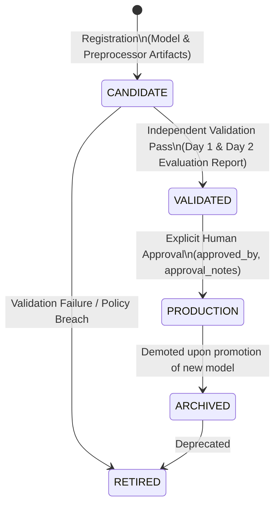

# TrafficShield Model Registry & Controlled Lifecycle Governance

**Milestone:** M12 — Intelligent Monitoring, Drift Detection & Model Lifecycle  
**Repository:** `D:\projects\TrafficShield`  
**Date:** 2026-10-23  

---

## 1. Governance Principles & Model Risk Management

Automated, continuous retraining on unlabelled network traffic is an anti-pattern in security operations. Unsupervised retraining without independent ground truth creates severe **feedback poisoning loops**:
- If a low-and-slow exfiltration campaign or novel botnet remains undetected for days, an automatic retraining pipeline incorporates those anomalous flows into the "normal" training baseline, rendering the model permanently blind to the ongoing breach.
- Furthermore, automated model promotion can silently degrade Day 2 temporal generalization without human review.

TrafficShield implements a **Controlled Lifecycle Governance Contract**:
1. **Zero Automated Retraining:** Models are never automatically retrained or updated on live traffic flows.
2. **Zero Automated Promotion:** No model candidate can automatically deploy to production.
3. **Immutable Artifact Freezing:** Every registered model is permanently anchored to its cryptographic SHA-256 artifact checksums.
4. **Independent Validation Gate:** Transition from `CANDIDATE` to `VALIDATED` requires auditable verification across both within-distribution (Day 1) and temporal out-of-distribution (Day 2) test partitions.
5. **Human Approval Audit Trail:** Transition from `VALIDATED` to `PRODUCTION` strictly requires explicit human sign-off (`approved_by`, `approval_notes`).

---

## 2. Model Lifecycle State Machine

### State Descriptions:
- **`CANDIDATE`**: A newly trained model submitted with declared architecture, preprocessor, and feature contract. Ineligible for production scoring.
- **`VALIDATED`**: The candidate has passed independent verification (feature policy compliance, zero leakage, Day 1 accuracy $\ge 98.0\%$, Day 2 temporal accuracy $\ge 96.5\%$).
- **`PRODUCTION`**: The single active inference engine used by `/api/v1/predict` and the SOC dashboard.
- **`ARCHIVED`**: A previously active production model preserved for auditability and rollback.
- **`RETIRED`**: Deprecated artifact no longer eligible for deployment.

---

## 3. Production Model Ledger Entry

The production inference engine is permanently registered in the database ledger:

| Attribute | Recorded Value |
|:---|:---|
| **Model Name** | `OptunaTuned_XGBoost` |
| **Model Version** | `1.0.0` |
| **Preprocessor Version** | `1.0.0` |
| **Model Artifact Checksum (SHA-256)** | `c43bb5cabd848f930eb7a977b730e401bd8204d6dd63170d1d2f2df2e4d27495` |
| **Preprocessor Checksum (SHA-256)** | `effe96e1977ce9687eb602a953f34f70a42ee1881bf678f59c40b99a1eecc653` |
| **Decision Threshold ($\tau$)** | `0.5` |
| **Feature Contract (13 Features)** | `duration_seconds`, `fwd_bytes`, `sttl`, `sload`, `fwd_packets`, `swin`, `smeansz`, `sjit`, `sintpkt`, `is_sm_ips_ports`, `packet_rate`, `byte_rate`, `bytes_per_packet` |
| **Training Provenance** | UNSW-NB15 Day 1 training partition (monotonically filtered, boundary deduplicated) |
| **Day 1 Held-Out Test Metrics** | Accuracy: 98.10%, Recall: 97.78%, Precision: 95.85%, Specificity: 98.24%, ROC-AUC: 0.9987 |
| **Day 2 Temporal Holdout Metrics** | Accuracy: 96.97%, Recall: 98.37%, Precision: 90.57%, Specificity: 96.50% |
| **Lifecycle State** | `PRODUCTION` (`is_active = True`) |
| **Promoted By** | `lead_mlops_architect` |
| **Approval Notes** | *"Initial deployment baseline: Verified via M9 independent reproduction report."* |

---

## 4. Promotion Enforcement Contract

The promotion routine (`ModelRegistryManager.promote_to_production`) enforces the following programmatic rules:
1. Rejects models that are in `CANDIDATE` state without prior validation (`HTTP 422: Must pass independent validation first`).
2. Rejects promotion requests lacking `approved_by` or `approval_notes` (`HTTP 400: Fields are strictly required`).
3. Atomically demotes all existing active production entries to `ARCHIVED`.
4. Deploys the promoted candidate as `is_active = True` and logs the action in the structured audit trail.
