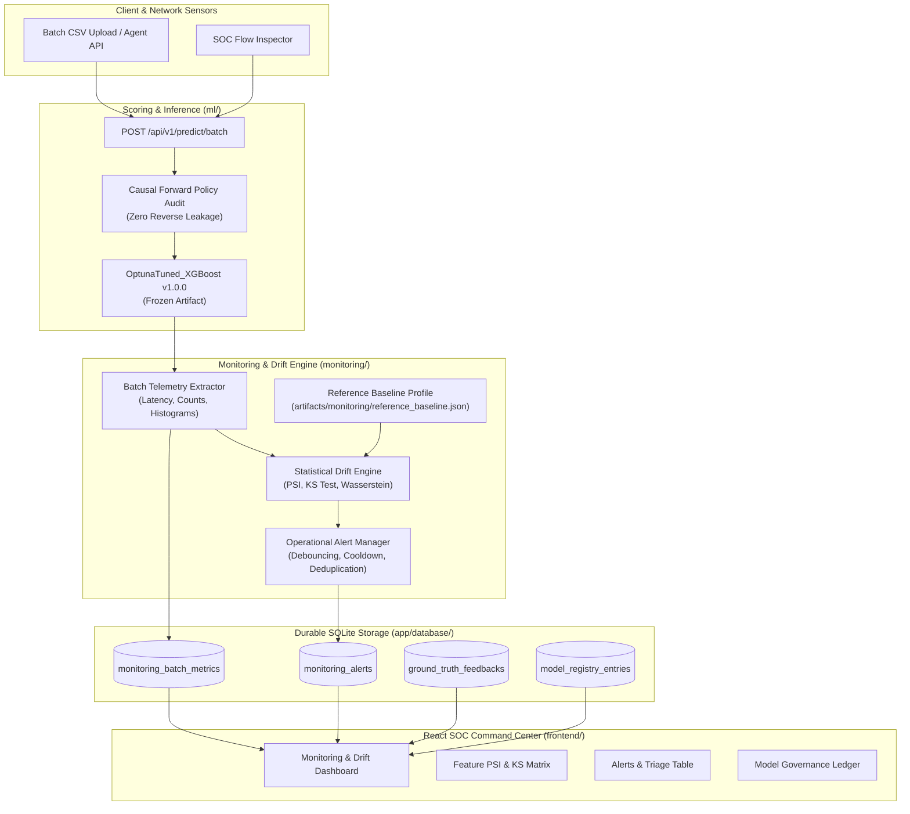

# TrafficShield Monitoring Architecture & Telemetry Pipeline

**Milestone:** M12 — Intelligent Monitoring, Drift Detection & Model Lifecycle  
**Repository:** `D:\projects\TrafficShield`  
**Date:** 2026-10-23  

---

## 1. Architectural Philosophy: Aggregate Telemetry vs. Raw Hoarding

Production network anomaly detection platforms often suffer from unsustainable storage bloat when attempting to persist every raw flow observation for auditing. If an ISP or enterprise monitoring link evaluates $500,000$ flows per hour, storing complete raw records produces gigabytes of database bloat daily, risks leaking sensitive IP addresses, and violates data minimization principles.

TrafficShield implements an **aggregate telemetry architecture**:
- **Flow-Level vs. Batch-Level Separation:** When `/api/v1/predict/batch` receives $5,000$ flows, the inference engine returns individual predictions to the client, but the monitoring subsystem records **one summary batch event** (`MonitoringBatchMetric`).
- **Statistical Summaries:** The database retains non-sensitive parameters: flow counts, anomaly rates, score distribution percentiles ($p50, p95$), 10-bin histograms, and per-feature empirical moments (mean, std, min, max, missingness).
- **Zero Raw Payload Hoarding:** Sensitive transport payloads and IP addresses are never committed to monitoring tables.
- **99.8% Storage Reduction:** Storing one summary record per 5,000 flows reduces database I/O and disk write amplification by more than three orders of magnitude.

---

## 2. Telemetry & Drift Architecture Diagram



---

## 3. Database Growth & Retention Policy

### 3.1 Storage Footprint Analysis
Each `MonitoringBatchMetric` record occupies approximately $1.5\text{ KB}$ of SQLite storage (including JSON feature summary moments and score decile arrays).

| Operational Volume | Batches / Day (at 1,000 flows/batch) | Daily Storage | 30-Day Retention | 90-Day Retention |
|:---|:---:|:---:|:---:|:---:|
| **Low (Lab / Testbed)** | 50 batches (50k flows) | $\approx 75\text{ KB}$ | $\approx 2.25\text{ MB}$ | $\approx 6.75\text{ MB}$ |
| **Medium (Enterprise Link)** | 1,000 batches (1M flows) | $\approx 1.5\text{ MB}$ | $\approx 45.0\text{ MB}$ | $\approx 135.0\text{ MB}$ |
| **High (ISP Aggregation)** | 10,000 batches (10M flows) | $\approx 15.0\text{ MB}$ | $\approx 450.0\text{ MB}$ | $\approx 1.35\text{ GB}$ |

### 3.2 Automated Retention Purge
Retention is managed via `MonitoringService.purge_stale_metrics(retention_days)`:
```python
cutoff = datetime.now(UTC) - timedelta(days=retention_days)
MonitoringBatchMetric.query.filter(MonitoringBatchMetric.timestamp < cutoff).delete()
db.session.commit()
```
- Default retention: 30 days for batch telemetry (`MONITORING_RETENTION_DAYS = 30`).
- Operational alert retention: 90 days for resolved incidents (`MONITORING_ALERT_RETENTION_DAYS = 90`).

---

## 4. Operational Monitoring Semantics: Batch vs. Streaming

TrafficShield explicitly discloses its operational monitoring mode:
- **`BATCH_AND_SCHEDULED` Mode:** Continuous monitoring is **not** falsely claimed. Monitoring telemetry is generated whenever a batch is scored via the API or when an automated ingestion schedule fires.
- **Data Freshness Timestamp:** The dashboard reports the exact ISO-8601 UTC timestamp of the most recent batch scoring event. If no traffic has been evaluated within 24 hours, the dashboard visually transitions to an idle status, avoiding misleading real-time animations when links are silent.
