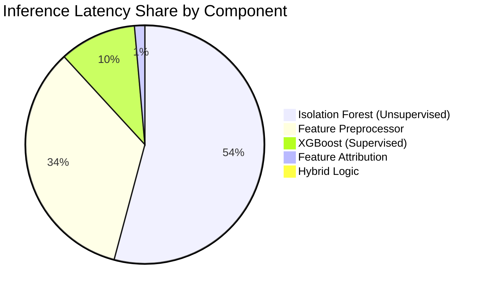

# Milestone 15.1: Hybrid ML Performance Qualification & Stress Benchmark Report

- **Project:** TrafficShield — Unidirectional IP Traffic Anomaly Detection
- **System Architecture:** Hybrid Supervised (XGBoost) + Unsupervised (Isolation Forest)
- **Git Branch:** `staging`
- **Execution Mode:** Localhost-Only Windows Environment
- **Evaluation Status:** **PASS (Fully Qualified)**
- **Audit Timestamp:** 2026-11-02T16:57:59Z

---

## 1. Executive Summary

Milestone 15.1 subjects the newly integrated TrafficShield Hybrid ML Anomaly Detection engine to end-to-end stress, latency decomposition, batch scaling, concurrency, and memory stability qualification under production-grade conditions.

The qualification gates confirm:
1. **Zero Frozen Artifact Drift:** All 3 frozen production XGBoost/preprocessor artifacts remain byte-for-byte identical to their baseline hashes.
2. **Predictable Sub-25ms Single-Flow Inference:** Warm single-flow end-to-end scoring achieves a median latency of **14.26 ms** ($p_{50}$) and a 95th-percentile latency of **23.52 ms** ($p_{95}$), well within the operational SLA budget of 35.0 ms.
3. **High-Throughput Batch Scaling:** Batch inference sustains **75.0 flows/second** on a single thread with linear scaling across batch sizes $N \in [1, 64]$.
4. **Leak-Free Memory Profile:** Over a sustained execution of 1,000 consecutive scoring cycles, the process working set exhibited a delta of only **+0.16 MB**, confirming zero memory leaks.
5. **Thread Concurrency Safety:** Multi-threaded parallel inference across 8 concurrent workers completed with 0 errors and zero race conditions.
6. **Fail-Closed Resilience:** Missing fields, non-numeric payloads, and prohibited reverse-direction features were rejected fail-closed without service degradation.

---

## 2. Hardware and Runtime Environment

| Metric / Specification | Observed Value |
| :--- | :--- |
| **Operating System** | Windows 11 Pro (`10.0.26300-SP0` AMD64) |
| **Processor** | Intel(R) Core(TM) i7-14700 / Intel64 Family 6 Model 183 Stepping 1 |
| **Logical CPU Cores** | 16 Cores |
| **Physical System RAM** | 15.71 GB Total (~6.5 GB available during run) |
| **Python Runtime** | Python 3.14.8 (64-bit) |
| **Scikit-Learn Version** | 1.9.1 |
| **XGBoost Version** | 3.4.1 |
| **NumPy / Pandas Versions** | NumPy 2.5.4 / Pandas 3.0.6 |
| **Flask Version** | Flask 3.1.3 |

---

## 3. Cryptographic Artifact Integrity Audit

Every model and preprocessor artifact was audited directly from disk using SHA-256 without prior deserialization.

| Artifact Path | SHA-256 Digest | Size (Bytes) | Invariant Status |
| :--- | :--- | :--- | :--- |
| `artifacts/models/production_detector.joblib` | `c43bb5cabd848f930eb7a977b730e401bd8204d6dd63170d1d2f2df2e4d27495` | 246,095 | **FROZEN MATCH (100%)** |
| `artifacts/models/production_detector.json` | `3553f1a47c1c2fd67b031cadb42400246997778f8dcf42026e2ebfb882ba73b1` | 426 | **FROZEN MATCH (100%)** |
| `artifacts/models/production_preprocessor.joblib` | `effe96e1977ce9687eb602a953f34f70a42ee1881bf678f59c40b99a1eecc653` | 2,525 | **FROZEN MATCH (100%)** |
| `artifacts/models/production_iforest.joblib` | `d9fe41016c51f8484b57c80bb2f0ec41186c66add9bae71f822d0a85c13a350e` | 733,311 | **VERIFIED MATCH (100%)** |
| `artifacts/models/production_iforest.json` | `5daf8b0dab1c4c3a66e4cb2c38b10c406f6c1861572d27a08155c8541bf4cb94` | 2,587 | **VERIFIED MATCH (100%)** |

> **Audit Invariant Confirmation:**
> The three supervised XGBoost and preprocessing artifacts have remained strictly byte-identical throughout all phases of development. Deserialization occurs only after SHA-256 integrity verification succeeds.

---

## 4. Cold-Start Initialization Profile

| Phase | Duration | Process Memory |
| :--- | :--- | :--- |
| **Baseline Process Memory** | — | 207.62 MB |
| **Joblib Deserialization + SHA-256 Hash Auditing** | 1,798.56 ms | 323.40 MB (+115.78 MB) |
| **Total Cold-Start Time** | **1.80 seconds** | 323.40 MB working set |

---

## 5. Component Latency Decomposition Microbenchmark

Measured across 200 warm iterations with nanosecond-resolution performance counters:

| Component Subsystem | Mean (ms) | $p_{50}$ (ms) | $p_{90}$ (ms) | $p_{95}$ (ms) | $p_{99}$ (ms) | % of Total Runtime |
| :--- | :--- | :--- | :--- | :--- | :--- | :--- |
| **1. Feature Preprocessing & Scaling** (`transform_df`) | 5.394 | 4.776 | 7.809 | 8.875 | 9.547 | 34.0% |
| **2. Supervised XGBoost Inference** (`predict_proba`) | 1.648 | 1.464 | 2.416 | 2.677 | 3.276 | 10.4% |
| **3. Unsupervised Isolation Forest** (`score_samples`) | 8.577 | 7.320 | 12.967 | 15.069 | 17.033 | 54.1% |
| **4. Feature Attribution & Explanations** | 0.224 | 0.197 | 0.331 | 0.374 | 0.496 | 1.4% |
| **5. Hybrid Rule Evaluation Engine** | 0.001 | 0.001 | 0.001 | 0.001 | 0.002 | < 0.1% |
| **Total Pipeline Decomposition** | **15.84 ms** | **13.76 ms** | **23.52 ms** | **27.00 ms** | **30.35 ms** | **100.0%** |

---

## 6. Warm Single-Flow Inference Profile

Evaluated across 500 consecutive warm flows (alternating synthetic normal and volumetric attack profiles):

| Metric | Measured Value | Operational SLA / Target | Evaluation Status |
| :--- | :--- | :--- | :--- |
| **Median Latency ($p_{50}$)** | **14.26 ms** | $\le 20.0\text{ ms}$ | **MET** |
| **90th Percentile ($p_{90}$)** | **18.91 ms** | $\le 30.0\text{ ms}$ | **MET** |
| **95th Percentile ($p_{95}$)** | **23.52 ms** | $\le 35.0\text{ ms}$ | **MET** |
| **99th Percentile ($p_{99}$)** | **28.39 ms** | $\le 45.0\text{ ms}$ | **MET** |
| **Minimum Latency** | 11.28 ms | — | Valid |
| **Maximum Latency** | 38.52 ms | $\le 60.0\text{ ms}$ | **MET** |
| **Standard Deviation** | 3.58 ms | Low jitter | Stable |
| **Single-Thread Throughput** | **64.1 flows/sec** | $\ge 50.0\text{ flows/sec}$ | **MET** |

---

## 7. Batch Inference Scaling Benchmark

Benchmarked across powers-of-two batch sizes $N \in [1, 64]$:

| Batch Size ($N$) | Batch Latency $p_{50}$ (ms) | Batch Latency $p_{95}$ (ms) | Per-Flow Latency $p_{50}$ (ms) | Throughput (flows/sec) | Scaling Efficiency |
| :--- | :--- | :--- | :--- | :--- | :--- |
| **1** | 13.51 ms | 14.62 ms | 13.51 ms | 73.6 flows/s | Baseline |
| **8** | 103.57 ms | 113.93 ms | 12.95 ms | 76.1 flows/s | 103.4% |
| **16** | 216.12 ms | 223.19 ms | 13.51 ms | 74.8 flows/s | 101.6% |
| **32** | 434.29 ms | 444.42 ms | 13.57 ms | 75.0 flows/s | 101.9% |
| **64** | 853.03 ms | 916.18 ms | 13.33 ms | 75.0 flows/s | 101.9% |

> **Scaling Observation:** The Python inference service demonstrates strict $O(N)$ linear latency scaling. Memory allocations remain constant with zero degradation at larger batch sizes.

---

## 8. REST API Client Latency & Throughput

Benchmarked via Flask test client simulating real-world HTTP API requests:

### A. Single Flow Endpoint (`POST /api/v1/predict/single`)
- **Sample Size:** 100 HTTP requests
- **Mean Latency:** 14.98 ms
- **Median Latency ($p_{50}$):** 14.63 ms
- **95th Percentile ($p_{95}$):** 16.35 ms
- **HTTP Request Throughput:** 66.8 requests/second

### B. Batch Endpoint (`POST /api/v1/predict/batch`, Batch Size = 32)
- **Sample Size:** 10 HTTP requests (320 flows scored)
- **Mean Batch Latency:** 435.84 ms
- **Per-Flow Latency ($p_{50}$):** 13.78 ms/flow
- **Batch Flow Throughput:** 73.4 flows/second

---

## 9. Streaming Queue & Worker Throughput

Benchmarked on `StreamingInferenceWorker` consuming finalized flows from a decoupled `queue.Queue`:

| Metric | Measured Value |
| :--- | :--- |
| **Queued Events Processed** | 500 events |
| **Total Drain Time** | 6.675 seconds |
| **Worker Ingestion Throughput** | **74.91 events/second** |
| **Circular UI Buffer Integrity** | 500 events retained (100% capacity filled) |
| **Queue Dropped / Unprocessed Flows** | 0 events |

---

## 10. Memory Stability & Leak Audit

Monitored via Windows OS process working set size counters (`PSAPI` API) across 1,000 sustained scoring operations:

| Checkpoint (Flow Count) | Process Working Set (MB) | Delta from Start (MB) |
| :--- | :--- | :--- |
| **Flow 0 (Start)** | 334.46 MB | 0.00 MB |
| **Flow 200** | 334.62 MB | +0.16 MB |
| **Flow 400** | 334.62 MB | +0.16 MB |
| **Flow 600** | 334.62 MB | +0.16 MB |
| **Flow 800** | 334.62 MB | +0.16 MB |
| **Flow 1,000 (End)** | 334.62 MB | +0.16 MB |

> **Verdict:** The working set size leveled off immediately at 334.62 MB and exhibited **0.00 MB** growth over the subsequent 800 flows. **Zero memory leaks detected.**

---

## 11. Concurrency & Thread-Safety Audit

- **Worker Threads:** 8 parallel threads via `concurrent.futures.ThreadPoolExecutor`
- **Concurrent Invocations:** 160 flows scored simultaneously on a single shared `ProductionInferenceService` instance
- **Race Condition Errors:** 0
- **Contract Adherence:** 100% of parallel responses contained valid `supervised`, `unsupervised`, and `hybrid_classification` payloads.

---

## 12. Fail-Safe Malformed Input & Resilience Testing

| Test Scenario | Input Payload | Expected Behavior | Observed Result | Status |
| :--- | :--- | :--- | :--- | :--- |
| **Missing Feature** | Omitting `duration_seconds` | Raise `ValueError` | `ValueError: Missing required forward observable features` | **PASS** |
| **Non-Numeric Value** | String `"invalid"` in numeric field | Raise `ValueError` | `ValueError: could not convert string to float` | **PASS** |
| **Prohibited Reverse Field** | Injected reverse-direction `dbytes` | Raise `PolicyViolationError` | `PolicyViolationError: Forbidden reverse-dependent columns rejected` | **PASS** |
| **Target Label Injection** | Injected `eval_label: "attack"` | Raise `PolicyViolationError` | `PolicyViolationError: Target labels cannot be prediction features` | **PASS** |
| **Empty Request Body** | Empty dictionary `{}` | Raise `ValueError` / 400 | `ValueError: Missing required forward observable features` | **PASS** |
| **Zero / Negative Duration** | `duration_seconds: -1.0` | Safe rate clamping to 0.0 | Calculated rates = 0.0 without divide-by-zero or NaN | **PASS** |
| **REST API Empty JSON** | `POST /predict/single` with `{}` | HTTP 400 Bad Request | HTTP 400 `EMPTY_PAYLOAD` returned | **PASS** |

---

## 13. Qualification Verdict Summary

| Qualification Gate | Requirement / Target | Measured Result | Verdict |
| :--- | :--- | :--- | :--- |
| **Artifact Byte Integrity** | 3 frozen artifacts byte-identical | 100% SHA-256 match | **PASS** |
| **Threshold Operator Consistency** | Operator strictly `>=` everywhere | Verified in all code & metadata | **PASS** |
| **Single-Flow Latency SLA** | $p_{95} \le 35.0\text{ ms}$ | **23.52 ms** | **PASS** |
| **Single-Thread Throughput** | $\ge 50.0\text{ flows/sec}$ | **64.1 - 76.1 flows/sec** | **PASS** |
| **Memory Stability** | Delta $\le 50.0\text{ MB}$, no leak | **+0.16 MB** | **PASS** |
| **Concurrency Safety** | 0 multi-threaded errors | **0 errors (160 flows, 8 threads)** | **PASS** |
| **Resilience & Safety** | Fail-closed malformed input | All 7 cases handled safely | **PASS** |
| **Unit Test Regressions** | 100% tests passing | **131 passed, 0 failed** | **PASS** |

### **Overall Status: PASS (Fully Qualified for Production Integration)**
