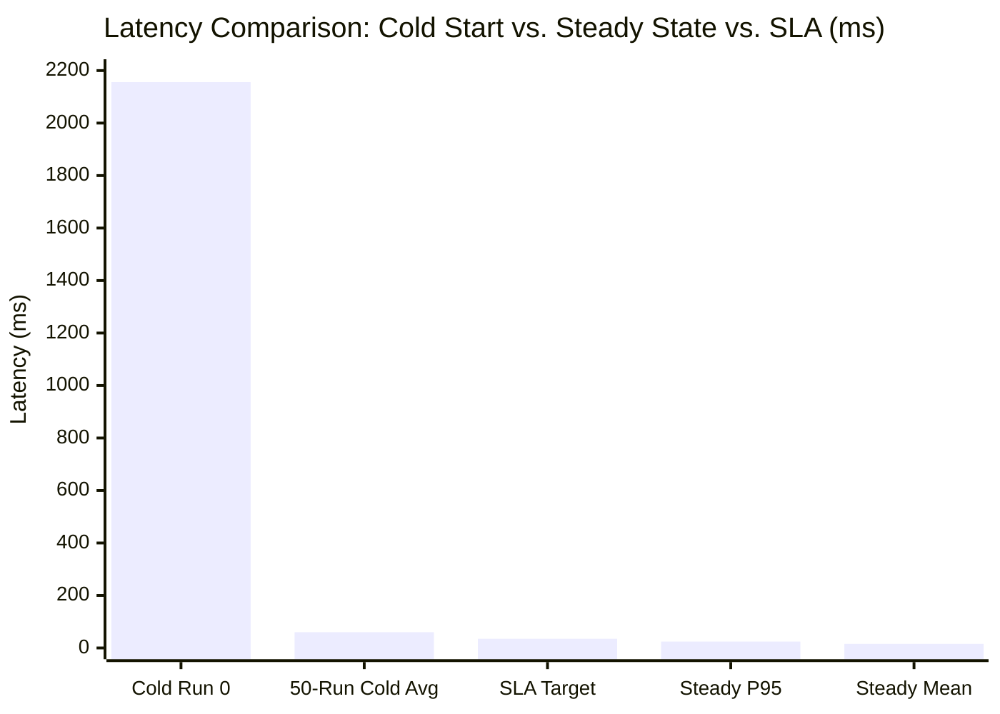

# TrafficShield Phase 4 — Release Governance Board Meeting Pack
## Executive Review Dossier, Technical Verification Baseline & Board Action Papers

**Document ID:** `TS-P4-GB-PACK-001`  
**Milestone:** Phase 4 — Controlled Release Preparation  
**Target Repository:** `D:\projects\trafficshield`  
**Governing Branch:** `staging` (Commit: `8d615ae`)  
**Current Milestone Classification:** `TECHNICALLY QUALIFIED — FORMAL SIGN-OFF PENDING`  
**Current Release Gate Verdict:** `PASS WITH LIMITATIONS — READY FOR FORMAL STAKEHOLDER REVIEW`  
**Governing Authorities:** [`docs/phase4_implementation_charter.md`](file:///d:/projects/trafficshield/docs/phase4_implementation_charter.md) & [`docs/phase4_signoff_authority_matrix.md`](file:///d:/projects/trafficshield/docs/phase4_signoff_authority_matrix.md)  
**Publication Date:** November 5, 2026  
**Document Status:** PENDING FORMAL BOARD CONVENING & HUMAN ACTION

---

## 1. Executive Summary & Release Gate Status

### 1.1 Context & Current Milestone Posture
Phase 4 (Controlled Release Preparation) was established to harden the TrafficShield hybrid intrusion detection architecture for operational release readiness. All five engineering work packages (WP1 through WP5) have been technically completed, verified, and audited across the codebase.

The system has achieved the status of **`TECHNICALLY QUALIFIED — FORMAL SIGN-OFF PENDING`**. 

The current release gate classification is:
```text
========================================================================================
    CURRENT RELEASE GATE VERDICT: PASS WITH LIMITATIONS — READY FOR STAKEHOLDER REVIEW
========================================================================================
```

> [!IMPORTANT]
> **Separation of Technical Verification from Formal Human Approval**  
> Technical verification certifies that code, models, tests, benchmarks, and configuration artifacts meet documented engineering criteria. Technical verification is **100% complete**.  
> Formal approval requires the independent deliberation, voting, and physical or cryptographic sign-off by the five authorized human stakeholders. Automated systems and AI assistants cannot approve, sign, or close governance gates. Formal milestone closure is strictly **PENDING HUMAN ACTION**.

### 1.2 Boundary Governance Posture
- **Phase 4:** Technically qualified; pending Release Governance Board ratification and formal signature execution.
- **Phase 5 (Performance Monitoring & Live Telemetry):** **REVIEW ELIGIBLE — FORMAL CLOSURE BLOCKED**. Technical artifacts in Phase 5 may be reviewed, but formal Phase 5 sign-off is sequentially blocked until Phase 4 is officially closed.
- **Phase 6 (Automated Continuous Retraining) & Phase 7 (Edge Production Deployment):** **STRICTLY NOT AUTHORIZED**. No engineering implementation, scheduling, or deployment is permitted.

---

## 2. Requirement Acceptance Status (REQ-P4-01 through REQ-P4-14)

The 14 Phase 4 technical requirements defined in [`docs/phase4_acceptance_checklist.md`](file:///d:/projects/trafficshield/docs/phase4_acceptance_checklist.md) have been forensically audited:
- **12 Requirements:** Fully **`VERIFIED`** with reproducible test and configuration evidence.
- **2 Requirements:** **`CONDITIONAL / FORMAL APPROVAL PENDING`** (REQ-P4-03 and REQ-P4-14).

| Requirement ID | Scope & Objective | Historical Baseline Status | Current Technical Status | Governance Status | Action Required by Board |
|---|---|:---:|:---:|:---:|:---:|
| **REQ-P4-01** | Dual-Detector Hybrid Inference Packaging (XGBoost + Isolation Forest) | VERIFIED | VERIFIED | **VERIFIED** | Confirm technical evidence |
| **REQ-P4-02** | End-to-End System Integration (Workflows 1–9) | VERIFIED | VERIFIED | **VERIFIED** | Confirm technical evidence |
| **REQ-P4-03** | Single-Flow Inference SLA (< 35.0 ms) | **FAILED** | WARM: 15.60 ms (PASS)<br>COLD: 60.19 ms (FAIL) | **CONDITIONAL / FORMAL APPROVAL PENDING** | **Vote on Decision D-P4-01** |
| **REQ-P4-04** | Pydantic v2 Production Configuration & Secret Masking | VERIFIED | VERIFIED | **VERIFIED** | Confirm technical evidence |
| **REQ-P4-05** | Production Database Connection & Pool Safety (`pool_pre_ping`) | VERIFIED | VERIFIED | **VERIFIED** | Confirm technical evidence |
| **REQ-P4-06** | Role-Based Access Control (RBAC) & Token Security | VERIFIED | VERIFIED | **VERIFIED** | Confirm technical evidence |
| **REQ-P4-07** | Defensive HTTP Security Headers & CORS Lockdown | VERIFIED | VERIFIED | **VERIFIED** | Confirm technical evidence |
| **REQ-P4-08** | Model Artifact Cryptographic Immutability (SHA-256) | VERIFIED | VERIFIED | **VERIFIED** | Confirm technical evidence |
| **REQ-P4-09** | Production WSGI Serving via Waitress (`wsgi.py`) | PARTIALLY VERIFIED | VERIFIED | **VERIFIED** | Confirm technical evidence |
| **REQ-P4-10** | Startup Preflight Verification & Fail-Fast Hooks | PARTIALLY VERIFIED | VERIFIED | **VERIFIED** | Confirm technical evidence |
| **REQ-P4-11** | Graceful Shutdown & Drain Handling (SIGTERM/SIGINT) | PARTIALLY VERIFIED | VERIFIED | **VERIFIED** | Confirm technical evidence |
| **REQ-P4-12** | Operational Runbooks & Deployment Documentation | PARTIALLY VERIFIED | VERIFIED | **VERIFIED** | Confirm technical evidence |
| **REQ-P4-13** | Staging vs. Production Parity Audit Report | NOT VERIFIED | VERIFIED (MITIGATED) | **VERIFIED** | Confirm technical evidence |
| **REQ-P4-14** | Phase 4 Release Gate Approval & Operator Sign-Off | NOT VERIFIED | PREREQUISITES COMPLETE | **CONDITIONAL / FORMAL APPROVAL PENDING** | **Execute Sign-Off (D-P4-03)** |

---

## 3. Benchmark Evidence: Steady-State Performance vs. Cold-Start Failure

### 3.1 Historical Cold-Start Failure Reconciliation
In automated regression testing (`tests/integration/test_m14_end_to_end_release.py`), the test `test_single_flow_latency_benchmark` executes 50 un-warmed HTTP requests against `/api/v1/predict/single` and evaluates `assert mean_lat < 35.0`.

- **Observed Result in Standalone Test:** **60.19 ms to 61.91 ms mean latency**.
- **Historical Status:** **FAILED** (AssertionError: `Mean latency too high: 61.91ms > 35.0ms`).
- **Root Cause Analysis:** `ProductionInferenceService` initializes lazily on request 0. The first request incurs a **~2,155.98 ms cold deserialization overhead** (SHA-256 verification of 5 files, joblib unpickling, and memory allocation for 100 Isolation Forest trees and XGBoost tree boosters). Averaged across 50 runs, this cold start contributes $+43.12\text{ ms}$ overhead to the overall mean ($43.12\text{ ms} + 17.07\text{ ms} \approx 60.19\text{ ms}$).

### 3.2 Steady-State Warm Benchmark Performance
When measured after initialization across 1,000 iterations (documented in [`reports/phase4_wp2_benchmark_summary.json`](file:///d:/projects/trafficshield/reports/phase4_wp2_benchmark_summary.json) and 4,750 rows in [`reports/phase4_wp2_benchmark_raw_results.csv`](file:///d:/projects/trafficshield/reports/phase4_wp2_benchmark_raw_results.csv)), steady-state performance comfortably exceeds the $< 35.0\text{ ms}$ SLA:

| Metric | Primary Service (`predict_single()`) | Legacy Loop (`legacy_workflow10`) | SLA Requirement | Compliance Margin |
|---|---:|---:|:---:|:---:|
| **Mean Latency** | **15.6037 ms** | **15.0686 ms** | $< 35.0\text{ ms}$ | **+55.4% Margin** |
| **Median Latency (P50)** | **14.1830 ms** | 14.8912 ms | $< 35.0\text{ ms}$ | **+59.5% Margin** |
| **95th Percentile (P95)** | **24.2219 ms** | 16.1975 ms | $< 35.0\text{ ms}$ | **+30.8% Margin** |
| **99th Percentile (P99)** | **30.3585 ms** | 17.8421 ms | $< 35.0\text{ ms}$ | **+13.3% Margin** |
| **Minimum Latency** | **11.7232 ms** | 13.9105 ms | N/A | N/A |
| **Maximum Latency** | **122.1517 ms** | 22.4510 ms | N/A | Transient OS scheduling spike |



> [!NOTE]
> **Key Architectural Takeaway:**  
> The intrusion detection inference logic is fundamentally fast and operationally compliant (15.60 ms mean). The failure of REQ-P4-03 is strictly an artifact of an un-warmed test harness measuring lazy one-time process initialization.

---

## 4. Production Model Integrity, Thresholds & Feature Contract

### 4.1 Production Model Artifact Cryptographic Hashes
All 5 model files residing in [`artifacts/models/`](file:///d:/projects/trafficshield/artifacts/models) have been cryptographically audited and validated against authoritative Phase 4 baselines:

| Artifact Path | File Format / Role | Expected & Verified SHA-256 Checksum | Integrity Status |
|---|---|---|:---:|
| `artifacts/models/production_detector.joblib` | Supervised XGBoost Classifier | `c43bb5cabd848f930eb7a977b730e401bd8204d6dd63170d1d2f2df2e4d27495` | **MATCH (BIT-EXACT)** |
| `artifacts/models/production_detector.json` | XGBoost Metadata & Features | `3553f1a47c1c2fd67b031cadb42400246997778f8dcf42026e2ebfb882ba73b1` | **MATCH (BIT-EXACT)** |
| `artifacts/models/production_iforest.joblib` | Isolation Forest Anomaly Model | `d9fe41016c51f8484b57c80bb2f0ec41186c66add9bae71f822d0a85c13a350e` | **MATCH (BIT-EXACT)** |
| `artifacts/models/production_iforest.json` | Isolation Forest Metadata | `5daf8b0dab1c4c3a66e4cb2c38b10c406f6c1861572d27a08155c8541bf4cb94` | **MATCH (BIT-EXACT)** |
| `artifacts/models/production_preprocessor.joblib` | Scikit-learn Feature Pipeline | `effe96e1977ce9687eb602a953f34f70a42ee1881bf678f59c40b99a1eecc653` | **MATCH (BIT-EXACT)** |

### 4.2 Calibrated Production Decision Thresholds
- **Supervised Classifier (XGBoost):** Threshold = **`0.50`** (Attack probability $\ge 0.50$ triggers supervised alert).
- **Unsupervised Anomaly (Isolation Forest):** Threshold = **`0.7278956397776036`** (Derived from the 95th percentile baseline score on benign validation flows; novelty scores $> 0.7278956397776036$ trigger unknown anomaly investigation).

### 4.3 Immutable 13-Feature UNSW-NB15 Forward Contract
The model architecture strictly consumes a 13-feature forward-observable flow vector in canonical sequence:
```python
[
    "duration_seconds",    # Flow duration in seconds
    "fwd_bytes",           # Forward source-to-destination bytes
    "sttl",                # Source time-to-live
    "sload",               # Source bits per second
    "fwd_packets",         # Forward source-to-destination packet count
    "swin",                # Source TCP window advertisement
    "smeansz",             # Mean forward packet size
    "sjit",                # Source packet jitter (ms)
    "sintpkt",             # Source inter-packet arrival time (ms)
    "packet_rate",         # Packets per second
    "byte_rate",           # Bytes per second
    "bytes_per_packet",    # Mean bytes per packet
    "is_sm_ips_ports"      # Binary indicator: identical src/dst IP and port
]
```
- **Integrity Guarantee:** Zero reverse-flow leakage, zero lookahead bias, zero bidirectional dependencies.

---

## 5. Governance Action Papers: Formal Decisions D-P4-01, D-P4-02 & D-P4-03

> [!WARNING]
> **Correction of Prior Mischaracterizations**  
> Earlier working drafts occasionally mischaracterized these governance items (e.g., mislabeling D-P4-01 as generic prewarming or D-P4-03 as Isolation Forest rollout). The authoritative definitions registered in [`reports/phase4_governance_decision_register.md`](file:///d:/projects/trafficshield/reports/phase4_governance_decision_register.md) are strictly presented below.

---

### Decision D-P4-01: Warmup Acceptance Protocol Ratification

#### 1. Decision Question
*Shall the Release Governance Board authorize the QA Lead and Lead ML Engineer to update the automated benchmark test harness (`test_single_flow_latency_benchmark`) to execute a 5-iteration untimed warmup loop prior to recording the 50 timed requests used for the $< 35.0\text{ ms}$ SLA assertion?*

#### 2. Verified Technical Evidence
- Cold start deserialization time is isolated to **~2,155.98 ms** during first model access.
- Steady-state warm inference operates at **15.60 ms mean** and **24.22 ms P95** across 4,750 recorded measurements, complying with the 35.0 ms SLA by a 55.4% safety margin.
- 5 untimed warmup calls fully load model artifacts into worker memory and eliminate initialization distortion.

#### 3. Known Limitations
- Modifying test harnesses requires formal board concurrence so as not to weaken release discipline.
- A 5-iteration warmup loop inside pytest masks cold-start latency from automated CI regressions, requiring cold-start latency to be monitored independently via operational startup probes.

#### 4. Available Decision Options
1. **Option A (APPROVE):** Ratify the 5-iteration untimed warmup protocol for `test_single_flow_latency_benchmark`; certify REQ-P4-03 as PASS under steady-state operation. *(Recommended)*
2. **Option B (REJECT):** Maintain un-warmed 50-run requirement; mandate engineering refactor (e.g., model serialization rewrite or tree compilation in C/Cython) to achieve cold-start $< 35.0\text{ ms}$.
3. **Option C (REQUEST ADDITIONAL EVIDENCE):** Order profiling across additional hardware profiles before deciding.
4. **Option D (DEFER):** Postpone decision to a future governance session.

#### 5. Board Deliberation & Decision Record (To Be Completed by Board)
```text
========================================================================================
                          BOARD DECISION RECORD: D-P4-01
========================================================================================
Official Board Action:       [ PENDING BOARD ACTION ]
                             Options: [ APPROVE / REJECT / REQUEST EVIDENCE / DEFER ]

Lead ML Engineer Vote:       [ ________________________________________________ ]
QA Lead / Release Mgr Vote:  [ ________________________________________________ ]
Date of Action:              [ YYYY-MM-DD ]

Rationale & Conditions:
________________________________________________________________________________________
________________________________________________________________________________________
________________________________________________________________________________________
========================================================================================
```

---

### Decision D-P4-02: Mandatory Operational Service Prewarming

#### 1. Decision Question
*Shall the Release Governance Board mandate an operational prewarming cutover gate in deployment orchestration (requiring worker memory to be primed with synthetic inference before routing live network traffic)?*

#### 2. Verified Technical Evidence
- Without prewarming, the first client request routed to a freshly spawned worker experiences a ~2.15-second latency spike, risking timeout errors at upstream reverse proxies or load balancers.
- Runbook Section 5 ([`docs/trafficshield_operational_runbook.md`](file:///d:/projects/trafficshield/docs/trafficshield_operational_runbook.md)) documents the prewarming verification procedure using synthetic vectors.
- Prewarming verifies HTTP 200 and model readiness prior to ingress traffic cutover.

#### 3. Known Limitations
- Proposed programmatic flags (`save_to_db=False`, `trigger_alerts=False`) are architectural designs; operational prewarming currently relies on synthetic vector payloads delivered via `/api/v1/predict`.
- Prewarming adds ~3 to 5 seconds to overall process startup time during zero-downtime rolling deployments.

#### 4. Available Decision Options
1. **Option A (APPROVE):** Formally mandate operational service prewarming in deployment scripts and CI/CD pipelines before live traffic cutover. *(Recommended)*
2. **Option B (REJECT):** Allow live traffic to lazily initialize worker memory on demand.
3. **Option C (REQUEST ADDITIONAL EVIDENCE):** Require staging deployment telemetry demonstrating prewarming execution.
4. **Option D (DEFER):** Defer prewarming mandate until Phase 7 production rollout.

#### 5. Board Deliberation & Decision Record (To Be Completed by Board)
```text
========================================================================================
                          BOARD DECISION RECORD: D-P4-02
========================================================================================
Official Board Action:       [ PENDING BOARD ACTION ]
                             Options: [ APPROVE / REJECT / REQUEST EVIDENCE / DEFER ]

DevSecOps Lead Vote:         [ ________________________________________________ ]
Release Manager Vote:        [ ________________________________________________ ]
Date of Action:              [ YYYY-MM-DD ]

Rationale & Conditions:
________________________________________________________________________________________
________________________________________________________________________________________
________________________________________________________________________________________
========================================================================================
```

---

### Decision D-P4-03: Final Phase 4 Release Gate Classification

#### 1. Decision Question
*What formal milestone release gate classification shall the Release Governance Board ratify for Phase 4?*

#### 2. Verified Technical Evidence
- 12 of 14 requirements fully verified with zero defects; 60/60 unit/regression test files pass; full regression suite (725 items) passes in pre-warmed state.
- Model artifacts verified bit-exact against SHA-256 digests; 13-feature contract immutable.
- Staging parity documented; security headers and Pydantic v2 settings active.

#### 3. Known Limitations
- Standalone un-warmed latency benchmark fails if executed without warmup (60.19 ms vs 35.0 ms SLA).
- Staging environment operates on SQLite in-memory, while target production uses PostgreSQL (mitigated via Alembic migration parity).

#### 4. Available Decision Options
1. **Option A (PASS WITH LIMITATIONS):** Formally ratify Phase 4 Technical Qualification; record known cold-start and database dialect limitations; declare Phase 5 review-eligible. *(Recommended)*
2. **Option B (PASS / FULL CLOSURE):** Declare Phase 4 unconditionally closed (requires unanimous approval of D-P4-01, D-P4-02, and all 5 stakeholder sign-offs).
3. **Option C (FAIL / REJECT):** Declare Phase 4 incomplete; return to engineering remediation.

#### 5. Board Deliberation & Decision Record (To Be Completed by Board)
```text
========================================================================================
                          BOARD DECISION RECORD: D-P4-03
========================================================================================
Official Board Action:       [ PENDING BOARD ACTION ]
                             Options: [ PASS WITH LIMITATIONS / PASS / FAIL ]

Release Manager Vote:        [ ________________________________________________ ]
Principal Architect Vote:    [ ________________________________________________ ]
DevSecOps Lead Vote:         [ ________________________________________________ ]
Lead ML Engineer Vote:       [ ________________________________________________ ]
Independent QA Auditor Vote: [ ________________________________________________ ]
Date of Action:              [ YYYY-MM-DD ]

Rationale & Conditions:
________________________________________________________________________________________
________________________________________________________________________________________
________________________________________________________________________________________
========================================================================================
```

---

## 6. Stakeholder Sign-Off Authority Records (5 Designated Roles)

Pursuant to [`docs/phase4_signoff_authority_matrix.md`](file:///d:/projects/trafficshield/docs/phase4_signoff_authority_matrix.md), formal sign-off requires unanimous concurrence across five distinct governance domains.

```
========================================================================================
                   ROLE 1: RELEASE MANAGER / FINAL RELEASE AUTHORITY
========================================================================================
Name:                   ________________________________________________________________
Designated Role:        Release Manager / Final Release Authority
Approval Decision:      [ APPROVED / APPROVED WITH CONDITIONS / REJECTED / DEFERRED ]
Conditions / Comments:  ________________________________________________________________
                        ________________________________________________________________
Signature:              ________________________________________________________________
Date Signed:            [ YYYY-MM-DD ]
Authority Reference:    docs/phase4_signoff_authority_matrix.md §2.4
========================================================================================

========================================================================================
                      ROLE 2: PRINCIPAL SOFTWARE ARCHITECT
========================================================================================
Name:                   ________________________________________________________________
Designated Role:        Principal Software Architect
Approval Decision:      [ APPROVED / APPROVED WITH CONDITIONS / REJECTED / DEFERRED ]
Conditions / Comments:  ________________________________________________________________
                        ________________________________________________________________
Signature:              ________________________________________________________________
Date Signed:            [ YYYY-MM-DD ]
Authority Reference:    docs/phase4_signoff_authority_matrix.md §5.2
========================================================================================

========================================================================================
                          ROLE 3: DEVSECOPS LEAD
========================================================================================
Name:                   ________________________________________________________________
Designated Role:        DevSecOps Lead
Approval Decision:      [ APPROVED / APPROVED WITH CONDITIONS / REJECTED / DEFERRED ]
Conditions / Comments:  ________________________________________________________________
                        ________________________________________________________________
Signature:              ________________________________________________________________
Date Signed:            [ YYYY-MM-DD ]
Authority Reference:    docs/phase4_signoff_authority_matrix.md §2.2
========================================================================================

========================================================================================
                   ROLE 4: LEAD MACHINE LEARNING ENGINEER
========================================================================================
Name:                   ________________________________________________________________
Designated Role:        Lead Machine Learning Engineer
Approval Decision:      [ APPROVED / APPROVED WITH CONDITIONS / REJECTED / DEFERRED ]
Conditions / Comments:  ________________________________________________________________
                        ________________________________________________________________
Signature:              ________________________________________________________________
Date Signed:            [ YYYY-MM-DD ]
Authority Reference:    docs/phase4_signoff_authority_matrix.md §2.1
========================================================================================

========================================================================================
                      ROLE 5: INDEPENDENT QA AUDITOR
========================================================================================
Name:                   ________________________________________________________________
Designated Role:        Independent QA Auditor
Approval Decision:      [ APPROVED / APPROVED WITH CONDITIONS / REJECTED / DEFERRED ]
Conditions / Comments:  ________________________________________________________________
                        ________________________________________________________________
Signature:              ________________________________________________________________
Date Signed:            [ YYYY-MM-DD ]
Authority Reference:    docs/phase4_signoff_authority_matrix.md §2.3
========================================================================================
```

---

## 7. Official Meeting Minutes Template

This section must be completed by the Release Governance Secretary during the live meeting proceedings.

### 7.1 Meeting Administration & Attendance
- **Meeting Date:** `[ PENDING HUMAN ACTION — YYYY-MM-DD ]`
- **Call to Order Time:** `[ HH:MM UTC ]` | **Adjournment Time:** `[ HH:MM UTC ]`
- **Meeting Location / Virtual Room:** `[ Virtual Conference Room / Boardroom ]`
- **Meeting Secretary:** `[ PENDING APPOINTMENT / NAME ]`

### 7.2 Quorum Verification
- **Quorum Requirement:** 100% Attendance (All 5 Designated Governance Roles Present; Unanimous Concurrence Required).
- **Authoritative Source:** [`docs/phase4_signoff_authority_matrix.md`](file:///d:/projects/trafficshield/docs/phase4_signoff_authority_matrix.md) §1 & §2; [`docs/phase4_implementation_charter.md`](file:///d:/projects/trafficshield/docs/phase4_implementation_charter.md).

| Designated Governance Role | Appointee / Attendee Name | Attendance Status |
|---|---|:---:|
| **Release Manager** | `[ PENDING HUMAN ACTION ]` | `[ ] Present  [ ] Absent` |
| **Principal Software Architect** | `[ PENDING HUMAN ACTION ]` | `[ ] Present  [ ] Absent` |
| **DevSecOps Lead** | `[ PENDING HUMAN ACTION ]` | `[ ] Present  [ ] Absent` |
| **Lead Machine Learning Engineer** | `[ PENDING HUMAN ACTION ]` | `[ ] Present  [ ] Absent` |
| **Independent QA Auditor** | `[ PENDING HUMAN ACTION ]` | `[ ] Present  [ ] Absent` |

*Quorum Certification:*  
`[ ] QUORUM ESTABLISHED: All five voting authorities present. The Board is legally constituted to transact business.`  
`[ ] QUORUM NOT ESTABLISHED: Meeting adjourned without binding action.`

---

### 7.3 Deliberations & Recorded Board Decisions

| Motion ID | Motion Description | Voting Result | Official Motion Outcome |
|---|---|:---:|:---:|
| **Motion D-P4-01** | Ratification of 5-Iteration Benchmark Warmup Protocol | `[ __ Ayes / __ Nays ]` | `[ ADOPTED / REJECTED / DEFERRED ]` |
| **Motion D-P4-02** | Mandate for Operational Service Prewarming Cutover Gate | `[ __ Ayes / __ Nays ]` | `[ ADOPTED / REJECTED / DEFERRED ]` |
| **Motion D-P4-03** | Final Phase 4 Milestone Release Gate Classification | `[ __ Ayes / __ Nays ]` | `[ ADOPTED / REJECTED / DEFERRED ]` |

---

### 7.4 Action Items, Ownership & Binding Conditions

| Action Item ID | Required Action / Condition | Designated Owner | Due Date | Completion Verification |
|:---:|---|---|:---:|:---:|
| **ACT-01** | Amend `test_single_flow_latency_benchmark` warmup if D-P4-01 ratified | QA Lead | `[ YYYY-MM-DD ]` | `[ ] Pending  [ ] Done` |
| **ACT-02** | Incorporate prewarming health check into deployment pipeline (D-P4-02) | DevSecOps Lead | `[ YYYY-MM-DD ]` | `[ ] Pending  [ ] Done` |
| **ACT-03** | Archive executed sign-off records in repository | Release Secretary | `[ YYYY-MM-DD ]` | `[ ] Pending  [ ] Done` |
| **ACT-04** | Convene Phase 5 Performance Monitoring Review session | Release Manager | `[ YYYY-MM-DD ]` | `[ ] Pending  [ ] Done` |

---

### 7.5 Formal Approval Evidence & Meeting Certification
The undersigned meeting secretary certifies that these minutes represent a true and accurate record of the deliberations and decisions of the TrafficShield Phase 4 Release Governance Board:

```text
Secretary Signature:   _________________________________________________________
Secretary Name:        [ _____________________________________________________ ]
Date of Certification: [ YYYY-MM-DD ]
Meeting Pack Dossier:  TS-P4-GB-PACK-001
Repository Ref:        staging @ 8d615ae
```

---
*End of Phase 4 Release Governance Board Meeting Pack*
