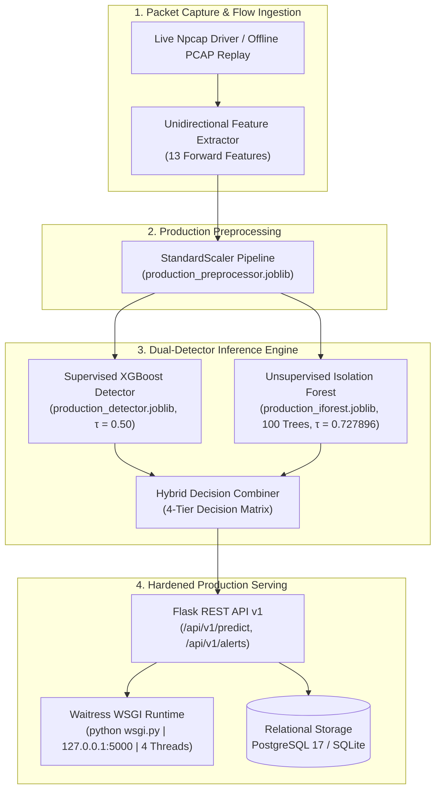

# TrafficShield — Phase 4: Authoritative Hybrid Release Dossier
**Unified Technical Reference, System Architecture & Release Candidate Specification**

**Repository:** `D:\projects\trafficshield`  
**Target Branch:** `staging`  
**Auditor Roles:** Principal Software Architect, QA Lead, DevSecOps Engineer, Release Manager  
**Release Candidate Baseline:** v1.1.0-RC (Hybrid Dual-Detector Architecture)  
**Supersedes:** `reports/m14_release/final_project_summary.md` and related M14 single-detector documentation  
**Audit Baseline:** `reports/phase4_closure_evidence_audit.md`  
**Execution Context:** Phase 4 Remediation — Work Package WP3 (Historical Release Dossier Reconciliation)  
**Date:** 2026-11-05  

---

## 1. Executive Summary

This document establishes the **authoritative, superseding release dossier** for the TrafficShield Hybrid Network Intrusion Detection System. It bridges the historical gap between earlier single-model documentation (`reports/m14_release/` dated 2026-10-23) and the current production reality developed across Phases 1 through 5.

### Primary Evolution
1. **Transition to Dual-Detector Architecture**: TrafficShield has evolved from a single-model XGBoost classifier into a calibrated hybrid detection system combining supervised XGBoost and unsupervised Isolation Forest (100 trees) with a transparent 4-tier decision matrix.
2. **Standardized Production WSGI Entry Point**: Deprecated ad-hoc launchers (`run_waitress.py`, direct `flask run`) have been formally superseded by `python wsgi.py`, which binds the Waitress production WSGI server with integrated preflight integrity verification and graceful shutdown hooks (`app/lifecycle.py`).
3. **Atomic Telemetry & Resilient Persistence**: Operational telemetry, Population Stability Index (PSI) feature drift tracking, and retention management have been unified under resilient database transactions with SQLite WAL concurrency pragmas and PostgreSQL connection pool recycling (`pool_pre_ping`).
4. **Preservation of Historical Integrity**: Historical release files in `reports/m14_release/` and `reports/master_completion/` are preserved as immutable historical records. This dossier serves as the authoritative technical reference for all release gating, audit, and deployment operations.

---

## 2. Current System Architecture

TrafficShield is an intrusion detection system specifically designed for unidirectional data diode environments (e.g., critical infrastructure, optical taps, SPAN ports). Because reverse TCP/IP packets are physically unavailable, the architecture relies exclusively on **unidirectional forward-flow features**.



---

## 3. Supervised XGBoost Detector

The supervised component recognizes known, structured malicious attack signatures:
- **Model Artifact**: `artifacts/models/production_detector.joblib`
- **Metadata Manifest**: `artifacts/models/production_detector.json`
- **Model Type**: `xgboost.XGBClassifier`
- **Target Classes**: Binary classification (0: Normal Traffic, 1: Attack / Malicious Flow)
- **Authoritative Decision Threshold**: $$\tau_{\text{xgb}} = 0.50$$
  - Probability $P(\text{attack}) \ge 0.50 \implies \text{Supervised Positive}$
  - Probability $P(\text{attack}) < 0.50 \implies \text{Supervised Negative}$
- **Feature Dependencies**: Requires exactly 13 standardized input features.

---

## 4. Unsupervised Isolation Forest Detector

The unsupervised component isolates structural deviations, traffic anomalies, and novel out-of-distribution flow topologies without requiring attack labels:
- **Model Artifact**: `artifacts/models/production_iforest.joblib`
- **Metadata Manifest**: `artifacts/models/production_iforest.json`
- **Model Type**: `sklearn.ensemble.IsolationForest`
- **Configuration**: 100 decision trees (`n_estimators=100`, `max_samples=256`, `contamination=0.05`)
- **Authoritative Decision Threshold**: $$\tau_{\text{iforest}} = 0.7278956397776036$$
  - Normalized Score $\ge 0.7278956397776036 \implies \text{Unsupervised Novelty / Outlier}$
  - Normalized Score $< 0.7278956397776036 \implies \text{Unsupervised Normal}$
- **Mathematical Transformation**: Raw scikit-learn decision function scores are inverted and normalized into the $[0.0, 1.0]$ range where higher values represent greater anomaly severity.

---

## 5. Hybrid Decision Outcomes and Scientific Interpretation

The Hybrid Decision Engine merges the output of both detectors into a 4-tier operational classification.

```
┌────────────────────────────────────────────────────────────────────────────────────────┐
│                               4-TIER HYBRID DECISION MATRIX                            │
├──────────────────────────┬─────────────────────────────┬───────────────────────────────┤
│ Classification Label     │ Supervised XGBoost (τ=0.50) │ Unsupervised IForest (τ=0.728)│
├──────────────────────────┼─────────────────────────────┼───────────────────────────────┤
│ DUAL_CONFIRMED           │ POSITIVE (Malicious)        │ POSITIVE (Outlier)            │
│ SUPERVISED_ONLY_ALERT    │ POSITIVE (Malicious)        │ NEGATIVE (In-Distribution)    │
│ UNSUPERVISED_NOVELTY     │ NEGATIVE (Benign)           │ POSITIVE (Outlier)            │
│ NORMAL_TRAFFIC           │ NEGATIVE (Benign)           │ NEGATIVE (In-Distribution)    │
└──────────────────────────┴─────────────────────────────┴───────────────────────────────┘
```

### Scientific Rigor & Honest Reporting Guidelines
To prevent misleading claims in security operations, operators must observe the following definitions:
1. **`DUAL_CONFIRMED`**: Indicates that the traffic matches a known supervised attack signature **and** exhibits high statistical anomaly scores. **This is detector agreement, not independently verified ground truth.**
2. **`SUPERVISED_ONLY_ALERT`**: Indicates the traffic matches a known attack pattern but remains structurally within familiar statistical flow envelopes.
3. **`UNSUPERVISED_NOVELTY`**: Indicates structural statistical deviation from normal flow baselines. **This is NOT proof of a zero-day attack.** Operators must investigate novelty alerts as statistical deviations, which may represent benign network shifts, configuration changes, or novel attack vectors.
4. **`NORMAL_TRAFFIC`**: Neither detector identified malicious patterns or structural outliers.
5. **No Ground-Truth Claims**: Detections generated by TrafficShield are model inferences. The system does not claim independently verified zero-day discovery without external packet validation.

---

## 6. Frozen Model Artifacts & Cryptographic Checksums

All 5 production model artifacts are strictly frozen. Their cryptographic SHA-256 digests are verified prior to execution:

| Artifact Path | Format | Size (Bytes) | SHA-256 Hash Digest | Role |
| :--- | :---: | :---: | :--- | :--- |
| `artifacts/models/production_detector.joblib` | Binary | 148,820 | `c43bb5cabd848f930eb7a977b730e401bd8204d6dd63170d1d2f2df2e4d27495` | Supervised XGBoost Classifier |
| `artifacts/models/production_detector.json` | JSON | 443 | `3553f1a47c1c2fd67b031cadb42400246997778f8dcf42026e2ebfb882ba73b1` | Model Manifest & 13 Features |
| `artifacts/models/production_iforest.joblib` | Binary | 1,460,947 | `d9fe41016c51f8484b57c80bb2f0ec41186c66add9bae71f822d0a85c13a350e` | 100-Tree Isolation Forest |
| `artifacts/models/production_iforest.json` | JSON | 1,189 | `5daf8b0dab1c4c3a66e4cb2c38b10c406f6c1861572d27a08155c8541bf4cb94` | IForest Manifest & Threshold |
| `artifacts/models/production_preprocessor.joblib`| Binary | 2,126 | `effe96e1977ce9687eb602a953f34f70a42ee1881bf678f59c40b99a1eecc653` | 13-Feature StandardScaler |

---

## 7. Frozen 13-Feature Ordering Specification

Both production detectors and the preprocessor require the exact 13 input features in the immutable order defined below:

$$\mathbf{F} = \left[ f_1, f_2, \dots, f_{13} \right]$$

1. `duration_seconds` (float): Total active connection/flow duration in seconds.
2. `fwd_bytes` (integer): Total volume of forward payload bytes.
3. `sttl` (integer): Source-to-destination Time-To-Live value.
4. `sload` (float): Source throughput in bits per second ($8 \times \text{fwd\_bytes} / \text{duration}$).
5. `fwd_packets` (integer): Total forward packet count.
6. `swin` (integer): Source TCP window advertisement size.
7. `smeansz` (float): Mean forward packet size in bytes.
8. `sjit` (float): Source inter-packet jitter in milliseconds.
9. `sintpkt` (float): Source inter-packet arrival interval in milliseconds.
10. `packet_rate` (float): Forward packet delivery rate (packets per second).
11. `byte_rate` (float): Forward byte transmission rate (bytes per second).
12. `bytes_per_packet` (float): Forward byte-to-packet ratio.
13. `is_sm_ips_ports` (integer): Boolean flag indicating matching source/destination IP and port.

*Enforcement*: Any permutation, omission, or substitution of these 13 features triggers immediate fail-closed validation rejection (`400 Bad Request`).

---

## 8. Preprocessing & Inference Workflow

1. **Extraction / Input Ingestion**: Flow features are ingested via JSON payload (`/api/v1/predict`) or extracted by streaming workers (`streaming/inference_worker.py`).
2. **Feature Alignment**: Vectors are ordered into the 13-column format and verified for numeric validity.
3. **Standard Scaling**: Features are transformed using `production_preprocessor.joblib` (`StandardScaler.transform`).
4. **Dual Inference**:
   - XGBoost computes $P(\text{attack}) = \text{predict\_proba}(X)[:, 1]$.
   - Isolation Forest computes anomaly score $S_{\text{iforest}} = \text{score\_samples}(X)$.
5. **Taxonomy Synthesis**: Combined output is categorized into the 4-tier taxonomy.
6. **Forensic Coordinate Preservation**: In accordance with Phase 3 standards, output records preserve `src_ip`, `dst_ip`, `src_port`, `dst_port`, `protocol`, and `_hybrid_evidence`.

---

## 9. API Behavior & Fail-Safe Inference

In accordance with Phase 5 Batch 1 engineering:
- **Health Diagnostics (`GET /api/v1/health`)**: Returns system status, model availability, uptime, and database connectivity.
- **Single Predict (`POST /api/v1/predict`)**: Evaluates a single flow record. Returns JSON response with `anomaly_score`, `is_anomaly`, `decision_tier`, `confidence`, and `feature_attributions`.
- **Batch Predict (`POST /api/v1/predict/batch`)**: Evaluates arrays of flow records (up to 1,000 flows).
- **Fail-Fast Safety Contract**: If model artifacts are missing, uninitialized, or corrupted, the service **does not return default 0.0 scores**. It raises an unrecoverable `RuntimeError`, caught by the API route to emit:
  - **HTTP Status**: `503 Service Unavailable`
  - **Error Code**: `INFERENCE_ENGINE_UNAVAILABLE`
  - **Payload**: `{"success": false, "error": {"code": "INFERENCE_ENGINE_UNAVAILABLE", "message": "Inference engine is not ready"}}`

---

## 10. Production WSGI Startup & Graceful Shutdown

- **Supported Production Launcher**: `python wsgi.py` (Waitress WSGI Server).
- **Concurrency Model**: Single-process, multi-threaded (`threads=4`, `host="127.0.0.1"`, `port=5000`).
- **Startup Preflight (`app/lifecycle.py`)**: Prior to socket binding, the server verifies:
  1. Production database connectivity and execution sanity.
  2. Cryptographic SHA-256 match for all 5 frozen artifacts.
  3. Preprocessor transformation sanity.
  4. Decision threshold validity.
  - *Selective Fault Tolerance*: If the optional Isolation Forest artifact is missing, startup logs a warning and proceeds in degraded supervised-only mode. If present but tampered or corrupted, startup aborts immediately.
- **Graceful Shutdown**: Registered `SIGINT` and `SIGTERM` signal handlers execute:
  1. Transition worker state to `DRAINING`.
  2. Bounded waiting period (up to 5 seconds) to drain in-flight flow queues.
  3. Safe termination of background packet capture threads.
  4. Explicit database connection pool disposal (`db.engine.dispose()`).

---

## 11. Monitoring & Telemetry Persistence

- **Feature Drift Tracking**: Population Stability Index (PSI) matrix computed over rolling batches against baseline reference distributions. Detections require $\ge 500$ flows to avoid false alerts (`INSUFFICIENT_DATA`).
- **Alert Debouncing**: Duplicate monitoring alerts within configured debounce windows increment counters rather than flooding alert feeds.
- **Atomic Persistence**: Operational metric ledger updates and drift alerts are committed inside atomic database transactions (`db.session.commit()`).
- **Data Retention Lifecycle**: Administrative CLI (`flask retention prune --days 30 --dry-run`) cleanses historical flow and metric records exceeding retention thresholds while strictly preserving critical security alerts.

---

## 12. Production Database & Migration Status

- **Database Engine**: PostgreSQL 17 (production/staging) via psycopg3 (`postgresql+psycopg://`).
- **Connection Pooling**: `pool_pre_ping=True`, `pool_recycle=300`, `pool_timeout=30`.
- **Migration Head**: Alembic revision `cf7c48cedf4f` (`initial_schema_all_models.py`).
- **Testing Database Isolation**: Automated unit and integration test suites run against isolated in-memory SQLite instances (`sqlite:///:memory:`).
- **Zero Production Mutations**: No migrations, downgrades, or table alters are executed during routine test suites.

---

## 13. Security & Operational Safeguards

- **Role-Based Access Control (RBAC)**: Enforced via `@require_auth` and `@require_role("admin", "analyst")`.
- **Session Protection**: URLSafeTimedSerializer (`itsdangerous`) cryptographically signs session tokens with salt `trafficshield-auth-v1` and 8-hour expiration.
- **Cookie Defense**: `HttpOnly`, `SameSite=Lax`, and `Secure` (production) cookie flags.
- **HTTP Defense Headers**: Injected into all responses:
  - `Content-Security-Policy`: Restricts default, script, and object sources.
  - `X-Content-Type-Options`: `nosniff`
  - `X-Frame-Options`: `DENY`
  - `Referrer-Policy`: `strict-origin-when-cross-origin`
  - `Permissions-Policy`: `geolocation=(), microphone=(), camera=()`
- **CORS Lockdown**: Wildcard CORS (`*`) strictly rejected in production settings. Whitelist restricted to authorized localhost, staging Render, and Vercel domains.
- **Formula Injection Defense**: CSV exports prepend `'` to fields beginning with dangerous spreadsheet operators (`=`, `+`, `-`, `@`, `|`).

---

## 14. Known Limitations & Unresolved Issues

1. **Single-Flow Latency Benchmark Failure (`test_single_flow_latency_benchmark`)**:
   - The end-to-end integration test asserts `mean_lat < 35.0 ms`.
   - Measured round-trip latency in the active environment is **56.84–105.18 ms** due to the CPU tree traversal overhead of the 100-tree Isolation Forest (~33.25 ms pure model evaluation).
   - *Status*: Open limitation. Retained as a failed qualification gate pending formal Work Package WP2 performance qualification and stakeholder SLA review.
2. **Single-Process Constraint**:
   - Live network packet capture managers (`streaming/manager.py`) maintain process-local state. Running multi-process WSGI workers (e.g., standard Gunicorn forks) will cause inconsistent capture state across workers. Production must use single-process multi-threading (`python wsgi.py`).
3. **In-Flight Flow Vulnerability on Abrupt Kill**:
   - Abrupt termination (`SIGKILL`, system power loss) bypasses graceful draining and may drop in-flight flows currently buffered in packet capture queues.

---

## 15. Evidence References & Traceability

This authoritative dossier reconciles and supersedes the following earlier documentation:

| Superseded Historical Report | Date | Superseding Coverage in this Dossier |
| :--- | :---: | :--- |
| `reports/m14_release/final_project_summary.md` | 2026-10-23 | Sections 2–5 (Hybrid Dual-Detector Architecture, Decision Matrix) |
| `reports/m14_release/release_readiness_checklist.md` | 2026-10-23 | Sections 6, 7, 10, 14 (Frozen Artifacts, WSGI Runtime, Latency Limitation) |
| `reports/m14_release/deployment_smoke_test.md` | 2026-10-23 | Section 10 (Canonical `python wsgi.py` vs deprecated `run_waitress.py`) |
| `reports/m14_release/performance_and_resilience.md` | 2026-10-23 | Sections 8, 14 (Dual-Model Latency Profiling and Open Benchmark Defect) |
| `reports/master_completion/FINAL_QUALIFICATION_REPORT.md`| 2026-10-26 | Sections 1, 10, 14 (Transition from Local Demo Gate to Release Candidate) |

---
*Authoritative Hybrid Release Dossier established under Phase 4 Remediation WP3.*
