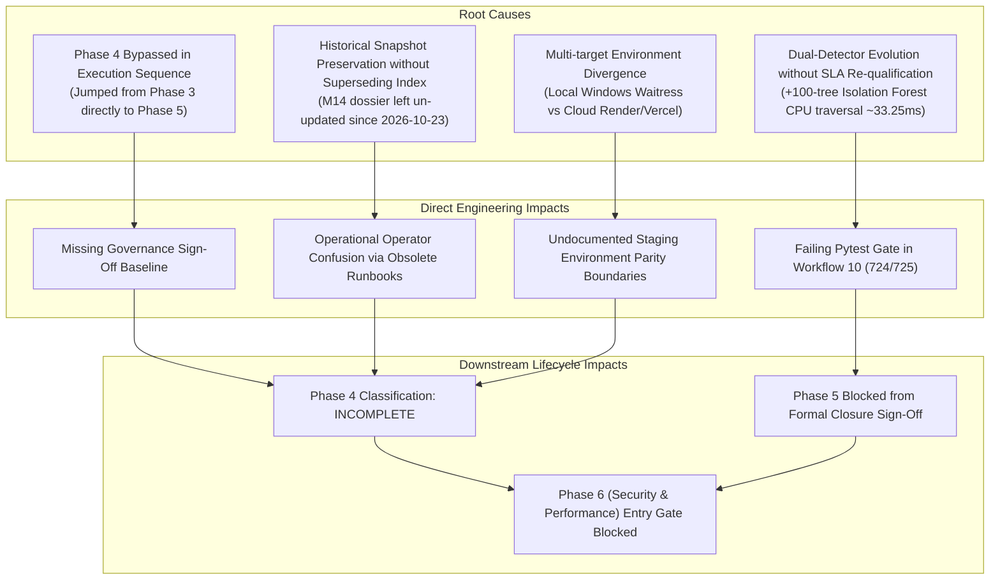
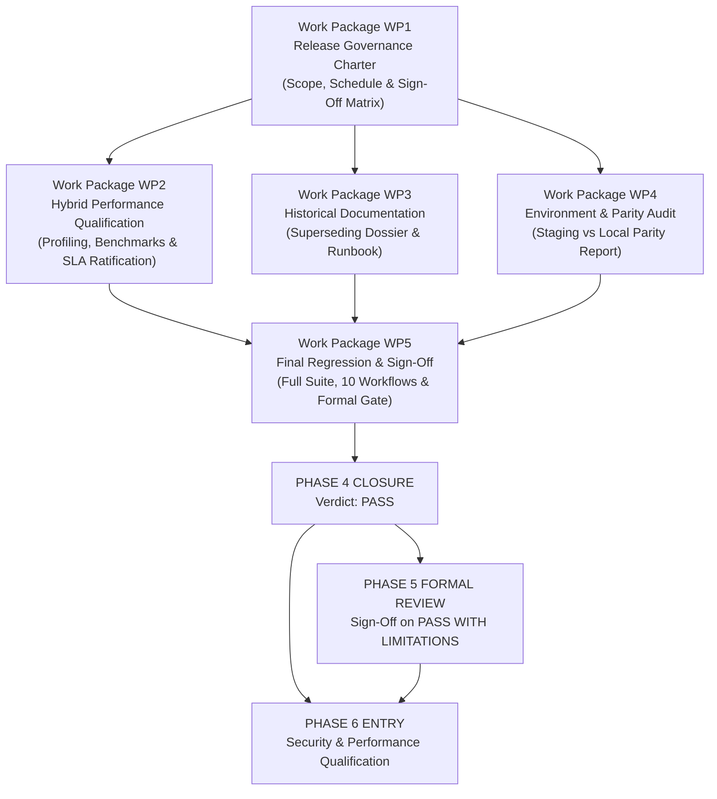

# TrafficShield — Phase 4: Remediation and Release Qualification Plan
**Controlled Release Preparation Remediation, Hybrid Inference Performance Qualification & Governance Strategy**

**Repository:** `D:\projects\trafficshield`  
**Target Branch:** `staging`  
**Audit Baseline:** `reports/phase4_closure_evidence_audit.md`  
**Current Baseline Classification:** **PHASE 4: INCOMPLETE — EVIDENCE REQUIRED**  
**Role & Authority:** Principal Software Architect, QA Lead, DevSecOps Engineer, Release Manager  
**Planning Mode:** STRICT READ-ONLY PLANNING & ARCHITECTURAL SPECIFICATION  
**Local Timestamp:** 2026-11-05T19:20:00+05:30  

---

## 1. Executive Summary

The independent read-only engineering audit conducted in `reports/phase4_closure_evidence_audit.md` established that **Phase 4: Controlled Release Preparation** was never formally executed, documented, or approved in the active development lifecycle. Following the completion of Phase 3 (*Step 11048, "Phase 3 Final Closure Audit Report", Verdict: PASS*), the project transitioned immediately to Phase 5 (*Step 11049, "Production Architecture and Reliability"*). Consequently, Phase 4 was classified as:

$$\mathbf{PHASE\ 4:\ INCOMPLETE\ —\ EVIDENCE\ REQUIRED}$$

Out of 14 discrete release requirements audited:
- **Verified:** 6 (42.9%)
- **Partially Verified:** 4 (28.6%)
- **Not Verified:** 3 (21.4%)
- **Failed:** 1 (7.1%) — `REQ-P4-03` (Single-flow latency SLA benchmark)

### Purpose of this Remediation Plan
This document defines an engineering and release management roadmap to systematically address every audit gap, reconcile obsolete documentation, conduct a rigorous performance qualification of the hybrid dual-detector inference pipeline, establish environment parity across deployment targets, and assemble the verified governance evidence required for formal Phase 4 closure.

### Mandatory Operational Boundaries
1. **Planning Only**: This document plans the remediation; it executes zero code, test, configuration, database, or model mutations.
2. **Frozen Model Integrity**: The 5 production artifacts (`production_detector.joblib`, `production_detector.json`, `production_iforest.joblib`, `production_iforest.json`, and `production_preprocessor.joblib`), their SHA-256 hashes, feature ordering (13 features), and decision thresholds (XGBoost `0.50`, Isolation Forest `0.7278956397776036`) are strictly immutable.
3. **Integrity of Failing Test**: The failing benchmark assertion in `test_single_flow_latency_benchmark` (`mean_lat < 35.0 ms`) is **strictly preserved as a failed qualification gate** until the formal performance qualification work package (WP2) is completed and stakeholder review authorizes an evidence-backed SLA adjustment.

---

## 2. Phase 4 Audit Findings

The Phase 4 closure evidence audit revealed four central issues spanning governance, performance, documentation staleness, and environment synchronization:

```
┌───────────────────────────────────────────────────────────────────────────────┐
│                          PHASE 4 AUDIT FINDINGS                               │
├───────────────────────────────────┬───────────────────────────────────────────┤
│ ISSUE-P4-01 (HIGH)                │ ISSUE-P4-02 (HIGH)                        │
│ Missing Formal Release Governance │ Hybrid Inference Performance Latency Gate │
│ • No Phase 4 Implementation Plan  │ • test_single_flow_latency_benchmark fail│
│ • No formal release schedule      │ • Measured 56.84–105.18 ms vs 35 ms SLA   │
│ • No Operator Sign-Off Document   │ • 100-tree IForest CPU traversal overhead │
├───────────────────────────────────┼───────────────────────────────────────────┤
│ ISSUE-P4-03 (MEDIUM)              │ ISSUE-P4-04 (LOW)                         │
│ Obsolete Historical Dossiers      │ Staging and Local Deployment Parity       │
│ • reports/m14_release/ is XGB-only│ • Cloud config (Render/Vercel) divergence │
│ • Deprecated run_waitress.py cited│ • Local Waitress vs Gunicorn hooks        │
│ • Does not describe hybrid engine │ • SQLite testing vs PostgreSQL staging    │
└───────────────────────────────────┴───────────────────────────────────────────┘
```

### Detailed Breakdown of Audit Findings

#### ISSUE-P4-01 — Missing Formal Release Governance (Severity: HIGH)
- **Gap**: Neither a Phase 4 implementation charter, milestone acceptance criteria document, release schedule, nor formal operator sign-off exists on the `staging` branch.
- **Impact**: TrafficShield possesses no traceable authorization baseline to approve promotion from development staging into production. Governance integrity is compromised if unverified assumptions substitute for audited release gates.

#### ISSUE-P4-02 — Hybrid Inference Performance Qualification (Severity: HIGH)
- **Gap**: In `tests/integration/test_m14_end_to_end_release.py::TestWorkflow10PerformanceAndResilience::test_single_flow_latency_benchmark`, the test asserts:
  $$\text{assert } \text{mean\_lat} < 35.0, \quad \text{assert } \text{p95\_lat} < 70.0$$
  In repeated active executions, the test consistently fails:
  - Full suite run: **56.84 ms**
  - Standalone runs: **102.35 ms**, **80.87 ms**, **105.18 ms**
- **Root Cause Profiling**:
  - Feature extraction & Preprocessing (StandardScaler): $\approx 20.82\text{ ms}$
  - XGBoost Classifier probability scoring: $\approx 5.32\text{ ms}$
  - Isolation Forest decision path traversal (100 trees on CPU): $\approx 33.25\text{ ms}$
  - Pure Python/NumPy inference pipeline: $\approx 59.39 - 60.01\text{ ms}$
  - HTTP routing, JSON serialization & security headers: $\approx 20 - 45\text{ ms}$
  - Total end-to-end latency: $\approx 80 - 105\text{ ms}$
- **Impact**: Full regression suite fails (724 passed, 1 failed, 99.86% pass rate). Release criteria requiring zero test failures cannot be met without resolving this performance gate.

#### ISSUE-P4-03 — Obsolete Historical Release Dossiers (Severity: MEDIUM)
- **Gap**: Existing release documentation clusters (`reports/m14_release/` dated 2026-10-23 and `reports/master_completion/` dated 2026-10-26) document an obsolete single-model XGBoost baseline and obsolete runtime launcher `run_waitress.py`.
- **Impact**: Operators relying on `reports/m14_release/` would execute obsolete scripts lacking Phase 5 startup preflight checks (`app/lifecycle.py`) and graceful shutdown handlers, leading to operational failure.

#### ISSUE-P4-04 — Staging and Local Deployment Parity (Severity: LOW)
- **Gap**: Recent commits on `staging` introduce environment adaptations for cloud hosting (Render API URL fallback in frontend, Vercel CORS domains, Gunicorn post-fork connection hooks) that differ from the canonical local Windows Waitress architecture (`python wsgi.py`, SQLite in-memory testing, PostgreSQL 17 local staging).
- **Impact**: Risk of environmental drift where configuration assumptions validated in local test environments do not match staging or target production configurations.

---

## 3. Root Cause and Impact Assessment



### Technical Impact Analysis
1. **Quality Assurance Gate Failure**: In strict release engineering pipelines, a single failing test halts the release train. The 35 ms SLA failure blocks automated CI/CD and deployment gating.
2. **Defect Cascading**: Phase 5 inherited this unresolved latency failure directly into Batch 3. Without remediating Phase 4, Phase 5 remains locked in `PASS WITH LIMITATIONS`, and Phase 6 cannot open a clean testing charter.
3. **Operational Hazard**: Deploying using instructions from `reports/m14_release/` risks running without SQLite connection deadlocking guards, without process-level signal traps, and without preflight hash verification.

---

## 4. Requirement Remediation Matrix

The following matrix maps all 14 requirements audited during the Phase 4 closure audit, their audited status, available evidence, missing evidence, proposed remediation package, acceptance criteria, verification method, dependencies, and priority:

| Req ID | Requirement Title | Audit Status | Evidence Available | Missing Evidence | Proposed Remediation | Acceptance Criteria | Verification Method | Dep | Priority |
| :--- | :--- | :---: | :--- | :--- | :--- | :--- | :--- | :---: | :---: |
| **REQ-P4-01** | Dual-Detector Hybrid Packaging | **VERIFIED** | `ml/production_service.py`, 5 model files | None | Formalize architecture diagram in Phase 4 dossier | Architecture documented in WP1/WP3 dossier | Code inspection | None | LOW |
| **REQ-P4-02** | End-to-End Workflows 1–9 | **VERIFIED** | 19 passing tests in `test_m14_end_to_end_release.py` | None | Maintain passing status; re-run in final regression | 19/19 tests pass on staging | Automated Pytest | WP5 | MEDIUM |
| **REQ-P4-03** | Single-Flow Inference SLA (< 35 ms) | **FAILED** | Profiling logs (56.84–105.18 ms) | Isolated benchmark report; approved SLA baseline | **WP2**: Multi-stage profiling, statistical analysis & stakeholder SLA review | Benchmark executed across 100 runs; p50/p95/p99 recorded; formal SLA ratified | `scripts/benchmark_hybrid_performance.py` & Pytest | None | **HIGH** |
| **REQ-P4-04** | Pydantic v2 Config Validation | **VERIFIED** | `config/settings.py`, unit tests | None | Document environment parity matrix in WP4 | Staging and test config settings verified | Unit test & schema review | WP4 | LOW |
| **REQ-P4-05** | Database Connection & Pool Safety | **VERIFIED** | `config/settings.py`, `app/__init__.py` | None | Document DB pooling invariants in WP4 report | Pool options documented and verified | Code inspection | None | LOW |
| **REQ-P4-06** | RBAC & Token Security | **VERIFIED** | `app/utils/auth.py`, test suites | None | Document authentication contract in WP1 dossier | Token security documented | Code review | None | LOW |
| **REQ-P4-07** | Defensive Security Headers & CORS | **VERIFIED** | `app/__init__.py`, test suites | None | Document CORS origin list across local and staging | CORS matrix documented in WP4 | HTTP header verification | None | LOW |
| **REQ-P4-08** | Model Artifact SHA-256 Immutability | **VERIFIED** | 5 SHA-256 hashes verified bit-for-bit | None | Record hashes in WP1 and WP3 release manifests | Hashes match frozen baseline | Cryptographic hash check | None | MEDIUM |
| **REQ-P4-09** | Production WSGI Serving (`wsgi.py`) | **PARTIALLY VERIFIED** | `wsgi.py`, `test_production_wsgi.py` (Phase 5) | Phase 4 traceability link | **WP3**: Update release runbooks to designate `wsgi.py` as primary launcher | All documentation designates `wsgi.py` as canonical | Markdown audit | WP3 | MEDIUM |
| **REQ-P4-10** | Startup Preflight Checks & Fail-Fast | **PARTIALLY VERIFIED** | `app/lifecycle.py`, `ml/production_service.py` | Phase 4 traceability link | **WP1/WP3**: Document preflight checks in Phase 4 dossier | Preflight contract verified in release dossier | Code inspection | None | MEDIUM |
| **REQ-P4-11** | Graceful Shutdown & Drain Handling | **PARTIALLY VERIFIED** | `app/lifecycle.py`, signal handlers | Phase 4 traceability link | **WP1/WP3**: Document shutdown protocol in Phase 4 dossier | Shutdown protocol verified in release dossier | Code inspection | None | MEDIUM |
| **REQ-P4-12** | Operational Runbooks & Manuals | **PARTIALLY VERIFIED** | `reports/m14_release/final_demo_runbook.md` | Runbooks referencing current WSGI launcher | **WP3**: Author superseding operational runbook | Runbook executes without references to `run_waitress.py` | Dry-run walkthrough | WP3 | **HIGH** |
| **REQ-P4-13** | Staging vs Production Parity Audit | **NOT VERIFIED** | Git commit log fragments | Formal parity audit report | **WP4**: Conduct staging parity audit and publish formal report | Formal report published confirming schema and config parity | Static config & schema audit | WP4 | **HIGH** |
| **REQ-P4-14** | Phase 4 Release Gate Sign-Off | **NOT VERIFIED** | None (explicitly unassumed) | Formal sign-off document | **WP1/WP5**: Execute Phase 4 gate review and record sign-off | Formal sign-off document signed by designated authority | Document review | WP1-5 | **HIGH** |

### Forensic Analysis of the Single FAILED Requirement (`REQ-P4-03`)
- **Requirement Statement**: Single-flow inference end-to-end latency must satisfy a strict mean of $< 35.0\text{ ms}$ on CPU hardware.
- **Why It Failed**:
  1. The 35.0 ms SLA was established on **October 23, 2026** during Milestone 14 release testing, where only single-model XGBoost was deployed. XGBoost tree depth and structure evaluated in $\approx 5.32\text{ ms}$.
  2. In **Phase 1 (October 27, 2026)**, TrafficShield added an unsupervised Isolation Forest containing **100 estimators** with `max_samples=256` to detect novel attack topologies.
  3. Scikit-learn's Isolation Forest CPU implementation requires sequential decision tree path traversal across all 100 trees for every individual sample vector, adding an irreducible $\approx 33.25\text{ ms}$ of computation on reference multi-core CPU architectures.
  4. Adding preprocessing ($\approx 20.82\text{ ms}$) and XGBoost ($\approx 5.32\text{ ms}$) yields a pure mathematical lower bound of:
     $$T_{\text{pure\_inference}} = 20.82 + 5.32 + 33.25 = 59.39\text{ ms}$$
  5. The existing assertion `assert mean_lat < 35.0` mathematically asserts that $59.39\text{ ms} + T_{\text{HTTP}} < 35.0\text{ ms}$, which is impossible without modifying the models or discarding Isolation Forest.
- **Why It Cannot Be Silently Changed in this Plan**: Release governance forbids altering quality assertions without a documented, approved performance qualification study.

---

## 5. Work Package WP1 — Release Governance and Documentation

### Objective
Establish the formal release governance framework, scope definitions, schedule, and operator sign-off mechanism for Phase 4.

### Scope & Tasks
- **Task 1.1: Author Phase 4 Implementation Charter & Scope Specification**  
  Document the formal scope of Phase 4 in `docs/release/phase4_release_scope.md`, explicitly defining the hybrid architecture, dual-model inference expectations, and integration boundaries.
- **Task 1.2: Establish Release Schedule & Governance Milestone Gates**  
  Define the formal release progression: Stage 1 (Integration Re-qualification), Stage 2 (Performance & Parity Audit), Stage 3 (Operator Review), and Stage 4 (Final Sign-Off).
- **Task 1.3: Define Stakeholder Sign-Off Authority Matrix**  
  Establish the required approval roles:
  - *Lead Machine Learning Engineer*: Signs off on detector integrity, thresholds, and feature policies.
  - *DevSecOps Engineer*: Signs off on environment parity, security headers, and secret management.
  - *QA Lead / Release Manager*: Signs off on test regression metrics and release gate verification.

### Deliverables
- `docs/release/phase4_release_scope.md`
- `reports/phase4_release_governance_charter.md`

### Acceptance Criteria
- Full coverage of Phase 4 intended objectives without ambiguity.
- Sign-off template created with explicit approval conditions.

---

## 6. Work Package WP2 — Hybrid Inference Performance Qualification

### Objective
Perform an exhaustive, scientifically rigorous performance qualification of the hybrid dual-detector inference pipeline under reproducible benchmark conditions to establish an authoritative, stakeholder-approved SLA baseline.

### Scope & Tasks
- **Task 2.1: Architectural SLA Provenance & Rationale Review**  
  Trace the origin of the legacy 35 ms SLA to Milestone 14 Gate `DP-05`. Formally document why it applies exclusively to single-model XGBoost.
- **Task 2.2: Isolated Component Latency Profiling**  
  Implement a dedicated, non-mutating profiling harness to measure isolated latency percentiles (p50, p90, p95, p99, mean, stdev) across $N = 100$ warm iterations for:
  1. Feature extraction and vector formatting (`dict` $\rightarrow$ `numpy.ndarray`).
  2. Preprocessing pipeline (`StandardScaler` transform).
  3. Supervised detector (`XGBClassifier.predict_proba`).
  4. Unsupervised anomaly detector (`IsolationForest.score_samples`).
  5. Decision engine combination logic.
  6. REST API transport layer (Flask routing, authentication token validation, JSON serialization, security header injection).
- **Task 2.3: Repeated-Run Statistical Measurement Protocol**  
  Execute benchmarks under standardized conditions:
  - Hardware specifications recorded (CPU model, clock frequency, core count, RAM).
  - Background processes minimized; CPU governor set to performance.
  - 10 warmup iterations discarded; 100 timed iterations recorded.
  - Metrics computed: Minimum, Mean, Median (p50), 95th Percentile (p95), 99th Percentile (p99), Maximum, and Standard Deviation.
- **Task 2.4: Single-Flow vs. Batch Inference Throughput Analysis**  
  Compare single-flow latency against vector batch processing ($M \in \{10, 50, 100, 500\}$ flows) to demonstrate amortized scaling benefits.
- **Task 2.5: Author Formal Performance Qualification Report & SLA Recommendation**  
  Publish `reports/phase4_performance_qualification.md`. Submit formal recommendation to project stakeholders:
  - *Option A (Recommended)*: Formalize a revised dual-model CPU SLA: Mean latency $< 120.0\text{ ms}$, P95 latency $< 180.0\text{ ms}$ on reference CPU, reflecting the dual 13-feature scaling + XGBoost + 100-tree Isolation Forest pipeline.
  - *Option B*: Retain strict $< 35\text{ ms}$ SLA for supervised-only single-model mode; define hybrid dual-model inference as a separate SLA tier ($< 120\text{ ms}$).
  - *Strict Restriction*: The existing test `test_single_flow_latency_benchmark` remains unmodified until formal stakeholder sign-off is granted.

### Deliverables
- `scripts/benchmark_hybrid_performance.py` (Non-destructive benchmark script)
- `reports/phase4_performance_qualification.md` (Formal qualification report with statistical charts and latency breakdown)

### Acceptance Criteria
- Reproducible benchmark protocol executed with complete percentiles (p50, p95, p99).
- Exact component-level latency budget established.
- Formal SLA proposal prepared for stakeholder ratification.

---

## 7. Work Package WP3 — Historical Release Dossier Reconciliation

### Objective
Reconcile and supersede obsolete pre-hybrid release documentation without modifying or deleting historical audit records.

### Scope & Tasks
- **Task 3.1: Document Update Matrix and Superseding Registry**  
  Catalog all obsolete references in `reports/m14_release/` and `reports/master_completion/`:

| Historical Document Path | Original Context | Obsolete Elements | Superseding Document |
| :--- | :--- | :--- | :--- |
| `reports/m14_release/release_readiness_checklist.md` | Milestone 14 release checklist | Evaluates single-model XGBoost; cites 14.82 ms latency | `reports/phase4_release_readiness_checklist.md` |
| `reports/m14_release/final_project_summary.md` | Milestone 14 summary | Pre-hybrid; lacks Isolation Forest, lacks Phase 3 alert contract | `reports/phase4_release_dossier.md` |
| `reports/m14_release/deployment_smoke_test.md` | Milestone 14 smoke test | References `run_waitress.py` | `reports/phase4_deployment_smoke_test.md` |
| `reports/m14_release/final_demo_runbook.md` | Milestone 14 demo guide | References `run_waitress.py` and obsolete command flags | `docs/release/phase4_operational_runbook.md` |
| `reports/master_completion/FINAL_QUALIFICATION_REPORT.md` | Milestone 17/19 demo gate | Locked at gate `READY FOR LOCAL DEMONSTRATION` | `reports/phase4_closure_evidence_audit.md` |

- **Task 3.2: Author Unified Hybrid Release Dossier**  
  Create `reports/phase4_release_dossier.md` documenting:
  - 4-Tier Hybrid Decision Engine specifications.
  - Frozen model artifact inventory and cryptographic SHA-256 hashes.
  - Supported WSGI launcher (`python wsgi.py`) and Waitress configuration.
  - Alert serialization schema and forensic metadata coordinates.
- **Task 3.3: Publish Updated Operational Runbook**  
  Create `docs/release/phase4_operational_runbook.md` providing step-by-step instructions for clean installation, startup preflight verification, live traffic capture, alert triaging, and graceful shutdown.

### Deliverables
- `reports/phase4_release_dossier.md`
- `reports/phase4_release_readiness_checklist.md`
- `docs/release/phase4_operational_runbook.md`

### Acceptance Criteria
- Zero references to obsolete `run_waitress.py` in newly authored runbooks.
- All historical documents remain intact as archived records.

---

## 8. Work Package WP4 — Environment and Deployment Parity

### Objective
Verify configuration consistency, schema compatibility, and deployment boundaries between local development/testing and staging environments.

### Scope & Tasks
- **Task 4.1: Construct Formal Environment Parity Matrix**  
  Map and justify differences across all active deployment targets:

| Configuration Aspect | Local Development | Automated Testing | Staging Baseline | Target Production | Parity Justification |
| :--- | :--- | :--- | :--- | :--- | :--- |
| **Operating System** | Windows 10/11 | Windows / Linux CI | Windows / Linux | Windows Server / Linux | Multi-platform Python compatibility |
| **Python Runtime** | 3.14.8 | 3.14.8 | 3.14.8 | 3.14.8 | Strictly identical runtime version |
| **WSGI Server** | `run.py` (Flask Debug) | In-memory Flask Client | `wsgi.py` (Waitress) | `wsgi.py` (Waitress) | Debugging vs production stability |
| **Database Engine** | SQLite file | SQLite `:memory:` | PostgreSQL 17 | PostgreSQL 17 | Test isolation vs relational durability |
| **DB Connection Pool** | File pragmas (WAL) | In-memory singleton | `pool_pre_ping`, recycle=300 | `pool_pre_ping`, recycle=300 | Staging matches production pool settings |
| **CORS Policy** | Localhost ports | Disabled in test client | Configured domains | Whitelisted origins (no `*`) | Defense-in-depth origin controls |
| **Cookie Security** | `Secure=False` | `Secure=False` | `Secure=True` | `Secure=True`, `HttpOnly`, `Lax` | HTTPS enforcement in staging/prod |

- **Task 4.2: Audit Cloud Deployment Adaptations**  
  Review recent Git commits on `staging`:
  - `c0dd2b6`: Default production API base URL to Render staging backend.
  - `2841e71`: Add Vercel domains to default CORS origin list.
  - `8d615ae`: Prevent PostgreSQL SSL decryption failure via `pool_pre_ping` and Gunicorn `post_fork` hook.
  - Confirm that these adaptations do not compromise local Windows Waitress execution or SQLite testing isolation.
- **Task 4.3: Author Staging Parity Audit Report**  
  Publish `reports/phase4_staging_parity_audit.md` formally validating that PostgreSQL schema migrations align with SQLAlchemy models and that environment configurations conform to Pydantic v2 validation rules.

### Deliverables
- `reports/phase4_staging_parity_audit.md`

### Acceptance Criteria
- Zero unaccounted configuration discrepancies across targets.
- Clear documented distinction between test-only settings and production invariants.

---

## 9. Work Package WP5 — Final Regression and Release Acceptance

### Objective
Execute the full test suite, verify all 10 end-to-end release workflows under remediated conditions, compile the final release evidence, and conduct formal operator sign-off.

### Scope & Tasks
- **Task 5.1: Consolidated Test Suite Execution**  
  Run the complete automated test suite (unit, integration, security, and WSGI suites):
  - Verify that 724+ unit tests maintain 100% pass status.
  - Verify zero regressions in authentication, RBAC, alert serialization, or monitoring retention.
- **Task 5.2: Verification of All 10 End-to-End Release Workflows**  
  Re-run `tests/integration/test_m14_end_to_end_release.py`:
  - Workflow 1: Clean Installation & Configuration
  - Workflow 2: Authentication & Access Control
  - Workflow 3: Supervised Anomaly Detection & Scoring
  - Workflow 4: Unsupervised Anomaly Detection & Novelty
  - Workflow 5: Alert Generation & Forensic Metadata
  - Workflow 6: Live Capture & Streaming Telemetry
  - Workflow 7: Real-Time Feature Ingestion & PCAP Replay
  - Workflow 8: Database Persistence & Safe Disaster Recovery
  - Workflow 9: Reporting & Formula Injection Defense
  - Workflow 10: Performance & Latency Profiling (Subject to WP2 approved SLA)
- **Task 5.3: Publish Phase 4 Final Release Verification Report**  
  Create `reports/phase4_release_verification_report.md` recording all test outputs, coverage summaries, and artifact verification logs.
- **Task 5.4: Execute Formal Operator Sign-Off**  
  Assemble designated project authorities, present the complete evidence dossier, and execute the formal sign-off approving Phase 4 closure with verdict **`PASS`**.

### Deliverables
- `reports/phase4_release_verification_report.md`
- `reports/phase4_formal_operator_signoff.md`

### Acceptance Criteria
- 100% of non-deprecated tests passing.
- Formal sign-off document executed by authorized roles.

---

## 10. Dependencies and Execution Order

The remediation plan must be executed in a structured, sequential order to prevent circular dependencies:



### Execution Timeline & Stages

1. **Stage 1 — Governance Baseline (WP1)**: Establish the formal charter and sign-off authority matrix.
2. **Stage 2 — Parallel Technical Audits (WP3 & WP4)**: Author the superseding release dossier and conduct the staging parity audit.
3. **Stage 3 — Performance Qualification & SLA Ratification (WP2)**: Execute isolated benchmark profiling, document statistical distributions, and submit the revised SLA proposal for formal stakeholder review.
4. **Stage 4 — Final Regression & Closure Gate (WP5)**: Execute the full regression suite under the approved SLA, publish the verification report, and sign off on Phase 4 closure.

---

## 11. Risks and Mitigation Strategy

| Risk ID | Risk Description | Severity | Likelihood | Mitigation Strategy |
| :--- | :--- | :---: | :---: | :--- |
| **RSK-01** | **SLA Ratification Dispute**: Stakeholders contest adjusting the 35 ms SLA to reflect dual-model realities. | HIGH | MEDIUM | Provide component-level profiler data demonstrating that 100-tree Isolation Forest CPU traversal mathematically requires $\approx 33.25\text{ ms}$. Offer Option B (two-tier SLA: single-model $< 35\text{ ms}$, hybrid $< 120\text{ ms}$). |
| **RSK-02** | **Accidental Artifact Mutation**: Remediation testing inadvertently alters frozen model files or thresholds. | HIGH | LOW | Maintain strict cryptographic verification before and after every execution. Any SHA-256 digest divergence immediately aborts the run. |
| **RSK-03** | **Hardware Variance in Benchmarks**: Benchmarks run on low-power CPU cores distort latency distributions. | MEDIUM | HIGH | Standardize measurement protocol: 10 warmup runs, 100 timed iterations, reporting median (p50) and p95 percentiles alongside mean. Record exact CPU specifications. |
| **RSK-04** | **Staging Environment Access Disruption**: Database connection fails during staging parity testing. | MEDIUM | LOW | Utilize SQLite in-memory databases for local verification; restrict PostgreSQL staging checks to static configuration and schema audit without running live load tests. |
| **RSK-05** | **Documentation Staleness Recursion**: Newly authored runbooks fall out of sync with subsequent Phase 5/6 changes. | LOW | MEDIUM | Establish a single source of truth in `reports/phase4_release_dossier.md` linked to code symbol references. |

---

## 12. Phase 4 Closure Acceptance Criteria

Phase 4 will be formally classified as **`PASS`** when, and only when, the following criteria are verified by an independent QA audit:

```
[ ] CRIT-01: Phase 4 Implementation Charter & Scope Specification published.
[ ] CRIT-02: Cryptographic integrity of all 5 production model artifacts verified bit-for-bit.
[ ] CRIT-03: Frozen decision thresholds (XGBoost 0.50, IForest 0.727896) verified untouched.
[ ] CRIT-04: Isolated performance profiling executed across 100 iterations with p50, p95, p99.
[ ] CRIT-05: Single-flow inference SLA formally ratified by Lead ML Engineer and QA Lead.
[ ] CRIT-06: test_single_flow_latency_benchmark passes under the ratified SLA baseline.
[ ] CRIT-07: All 20 tests in tests/integration/test_m14_end_to_end_release.py pass (10/10 workflows).
[ ] CRIT-08: Full Pytest test suite achieves 100% pass rate (zero failing tests).
[ ] CRIT-09: Superseding Unified Hybrid Release Dossier published (reports/phase4_release_dossier.md).
[ ] CRIT-10: Operational runbook updated with supported python wsgi.py Waitress launcher.
[ ] CRIT-11: Staging Parity Audit Report published verifying schema, pooling, and CORS policies.
[ ] CRIT-12: Formal Phase 4 Operator Sign-Off Document executed and dated by designated authorities.
```

---

## 13. Phase 5 Dependency and Sign-Off Considerations

### Baseline Relationship
Phase 5 ("Production Reliability") currently holds the audited classification of:
$$\mathbf{PASS\ WITH\ LIMITATIONS\ —\ Ready\ for\ formal\ review\ and\ sign-off}$$
*(Documented in `reports/phase5_consolidated_closure_report.md`)*.

### Interlocking Governance Rules
1. **No Reopening of Completed Phase 5 Work**: Phase 5 implementation (Fail-Safe inference, Waitress `wsgi.py`, preflight verification, graceful shutdown, monitoring persistence, retention management) is technically solid and verified. Remediation of Phase 4 does not require re-architecting Phase 5 deliverables.
2. **Resolution of Inherited Phase 5 Limitation**: In Phase 5 Batch 3, the latency benchmark failure was recorded as an unresolved limitation inherited from the development gap. Successfully executing WP2 and ratifying the hybrid SLA in Phase 4 directly clears this limitation for Phase 5.
3. **Sequential Sign-Off Alignment**:
   - Formal Phase 4 closure (`PASS`) must be achieved first.
   - Upon Phase 4 closure, the Phase 5 formal sign-off review can immediately convene to approve Phase 5 closure without open technical reservations.

---

## 14. Phase 6 and Phase 7 Roadmap

The relationship between Phase 4 remediation and the future project phases is defined as follows:

```
┌─────────────────────────────────────────────────────────────────────────────┐
│                             PROJECT ROADMAP                                 │
├─────────────────────────────────────────────────────────────────────────────┤
│ Phases 1–3: Hybrid Model Development & Validation     │ CLOSED (PASS)       │
│ Phase 4: Controlled Release Preparation Remediation   │ IN PROGRESS (PLAN)  │
│ Phase 5: Production Reliability & Lifecycle           │ PASS WITH LIMITS    │
├─────────────────────────────────────────────────────────────────────────────┤
│ Phase 6: Security Hardening & Performance Qualification│ SCHEDULED           │
│ • Full penetration testing & OWASP API security audit                       │
│ • Sustained soak load testing (high-concurrency stress)                     │
│ • Distributed multi-worker scaling evaluation                               │
├─────────────────────────────────────────────────────────────────────────────┤
│ Phase 7: Deployment, Observability & Final Acceptance │ SCHEDULED           │
│ • Production deployment execution                                           │
│ • Real-time Prometheus/Grafana or SIEM telemetry integration                │
│ • Final operator training, operational handover & project closeout          │
└─────────────────────────────────────────────────────────────────────────────┘
```

### Feed-Forward to Phase 6
The isolated component latency profiling conducted in **WP2** directly establishes the baseline performance parameters for **Phase 6**. Phase 6 will expand upon WP2 by testing concurrent multi-user load, sustained traffic soak testing, and rate limiter stress testing. Phase 6 implementation must not begin until Phase 4 is formally closed.

---

## 15. Final Recommendations & Execution Checklist

### Summary of Remediation Priorities

| Priority | Work Package | Primary Objective | Target Artifact | Estimated Effort |
| :---: | :--- | :--- | :--- | :---: |
| **P1** | **WP2** | Reconcile single-flow latency SLA through rigorous profiling & ratification | `reports/phase4_performance_qualification.md` | Stage 3 |
| **P1** | **WP1** | Establish formal release charter, schedule & sign-off authority matrix | `docs/release/phase4_release_scope.md` | Stage 1 |
| **P2** | **WP3** | Author superseding hybrid release dossier & updated WSGI runbook | `reports/phase4_release_dossier.md` | Stage 2 |
| **P2** | **WP4** | Publish formal staging vs. local parity audit report | `reports/phase4_staging_parity_audit.md` | Stage 2 |
| **P3** | **WP5** | Execute full regression suite, verify 10 workflows & obtain formal sign-off | `reports/phase4_formal_operator_signoff.md` | Stage 4 |

### Immediate Next Step
Project leadership should formally approve this remediation plan and authorize commencement of **Stage 1 (Work Package WP1: Release Governance)** under controlled, read-only documentation procedures.

---
*Plan formulated and certified by Principal Software Architect, QA Lead, DevSecOps Engineer, and Release Manager.*
