# TrafficShield — Phase 4: WP2 Benchmark Environment Specification
**Hardware, Operating System, Runtime & Reproducibility Environment Ledger**

**Project:** TrafficShield — Hybrid Network Intrusion Detection System (Hybrid IDS)  
**Repository:** `D:\projects\trafficshield`  
**Execution Context:** Work Package WP2 — Hybrid Inference Performance Qualification  
**Audit Baseline:** `reports/phase4_closure_evidence_audit.md`  
**Date:** 2026-11-05  

---

## 1. Hardware Environment

| Hardware Parameter | Specification / Measured Value | Source / Detection Method |
| :--- | :--- | :--- |
| **Processor Model** | Intel64 Family 6 Model 183 Stepping 1, GenuineIntel (13th/14th Gen Intel Core Architecture) | `platform.processor()` |
| **Logical Core Count** | 16 logical cores | `os.cpu_count()` |
| **Physical Architecture**| x86_64 / Intel64 | `platform.machine()` |
| **Total Physical RAM** | 15.71 GB | `ctypes.windll.kernel32.GlobalMemoryStatusEx` |
| **CPU Clock & Governor**| Balanced / Dynamic Scaling | Windows Default Power Profile |
| **Storage Subsystem** | Solid-State Drive (NVMe SSD) | Physical Local Drive D:\ |

---

## 2. Operating System & Platform Configuration

| Platform Parameter | Specification / Setting |
| :--- | :--- |
| **Operating System** | Windows 11 Enterprise (Version 10.0.26300, Build 26300, SP0) |
| **Platform String** | `Windows-11-10.0.26300-SP0` |
| **User Mode** | Standard Operator / Developer Console |
| **Terminal Shell** | PowerShell 7 / Windows Terminal |

---

## 3. Runtime & Inference Dependency Versions

| Software Component | Installed Version | Role in Inference Pipeline |
| :--- | :--- | :--- |
| **Python** | 3.14.8 | Core language runtime |
| **Scikit-Learn** | 1.9.1 | Isolation Forest tree traversal & StandardScaler transform |
| **XGBoost** | 3.4.1 | Supervised gradient-boosted decision tree classifier |
| **NumPy** | 2.5.4 | Vector math and multi-dimensional array operations |
| **Pandas** | 3.0.6 | Dataframe construction and feature column alignment |
| **Flask** | 3.1.3 | REST API application framework |
| **SQLAlchemy** | 2.1.6 | Database abstraction & connection pooling |
| **Pytest** | 9.1.1 | Test execution harness |

---

## 4. Benchmark Measurement Boundaries & Timing Architecture

```mermaid
flowchart TD
    subgraph TimingBoundary1["Boundary 1: Component Microbenchmark (Pure Computation)"]
        CB_PREP["StandardScaler.transform_df (df -> ndarray)"]
        CB_XGB["XGBClassifier.predict_proba (13 features -> P(attack))"]
        CB_IF["IsolationForest.score_samples (100 Trees -> score)"]
        CB_ATTRIB["Feature Attribution (Top contributors)"]
        CB_DEC["Decision Combiner (4-Tier classification logic)"]
    end

    subgraph TimingBoundary2["Boundary 2: Service Level (ProductionInferenceService.predict_single)"]
        SER_VAL["validate_and_prepare_input (dict -> DataFrame)"]
        SER_CORE["Boundary 1 (Prep + XGB + IForest + Attrib + Decision)"]
        SER_DICT["Response Dictionary Construction"]
        SER_VAL --> SER_CORE --> SER_DICT
    end

    subgraph TimingBoundary3["Boundary 3: HTTP API Level (Flask Test Client /api/v1/predict)"]
        HTTP_ROUT["Flask Routing & WSGI Dispatch"]
        HTTP_AUTH["Token Extraction & itsdangerous URLSafeTimedSerializer Verification"]
        HTTP_PARSE["JSON Request Body Parsing & Payload Validation"]
        HTTP_SVC["Boundary 2 (Service.predict_single)"]
        HTTP_HEAD["Defense Headers Injection (CSP, nosniff, DENY, Correlation ID)"]
        HTTP_RESP["JSON Response Serialization & Return"]
        HTTP_ROUT --> HTTP_AUTH --> HTTP_PARSE --> HTTP_SVC --> HTTP_HEAD --> HTTP_RESP
    end

    subgraph TimingBoundary4["Boundary 4: Legacy Test Loop (test_single_flow_latency_benchmark)"]
        LEG_COLD["Cold-Start Model & Preprocessor Deserialization (Run 0: ~2.15s)"]
        LEG_WARM["Boundary 3 Executed 49 Times (~15.89 ms per run)"]
        LEG_COLD --> LEG_WARM
    end
```

---

## 5. Test Isolation & Database Protection Invariants

- **Isolated Test Mode**: Injected `FLASK_ENV=testing`, `APP_ENV=testing`.
- **Database Isolation**: `TEST_DATABASE_URL=sqlite:///:memory:`. Zero connection or write attempts to `trafficshield_prod`.
- **Timer Mechanism**: Monotonic high-resolution timer (`time.perf_counter()`), providing sub-microsecond precision on modern x86_64 architectures.
- **Warmup Protocol**: Exactly 10 warmup iterations executed before each measurement series to ensure JIT, caching, and CPU instruction branch prediction stabilization.

---
*Environment specification documented under Phase 4 Remediation WP2.*
